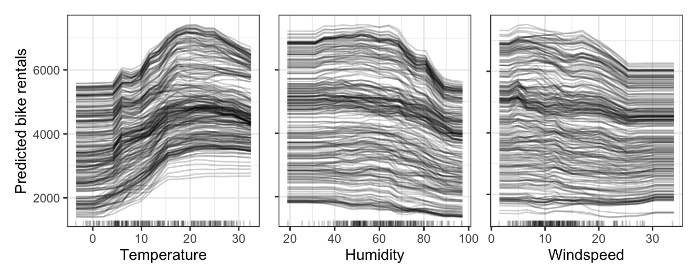
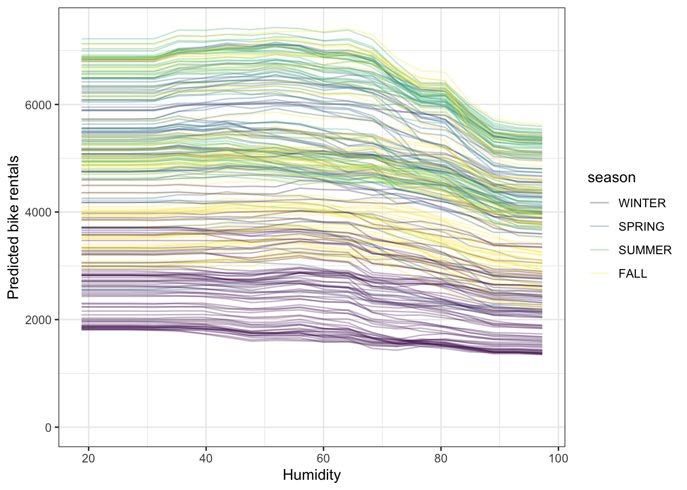
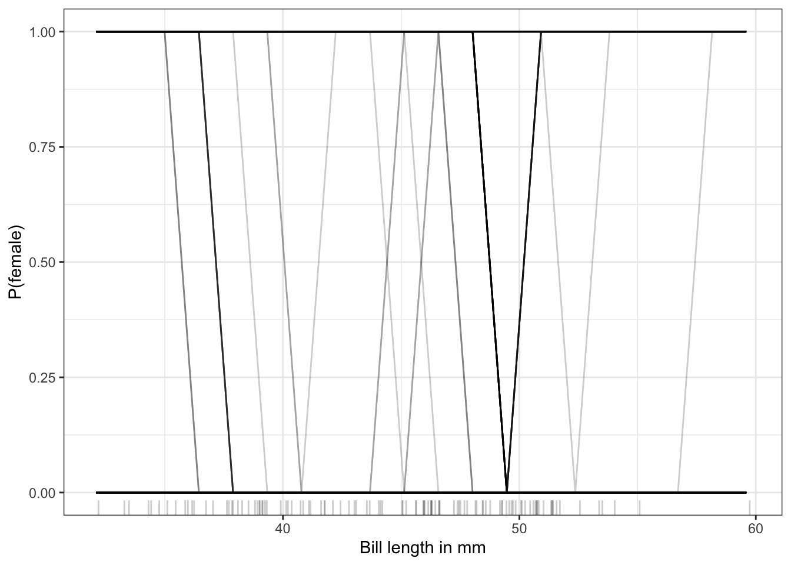
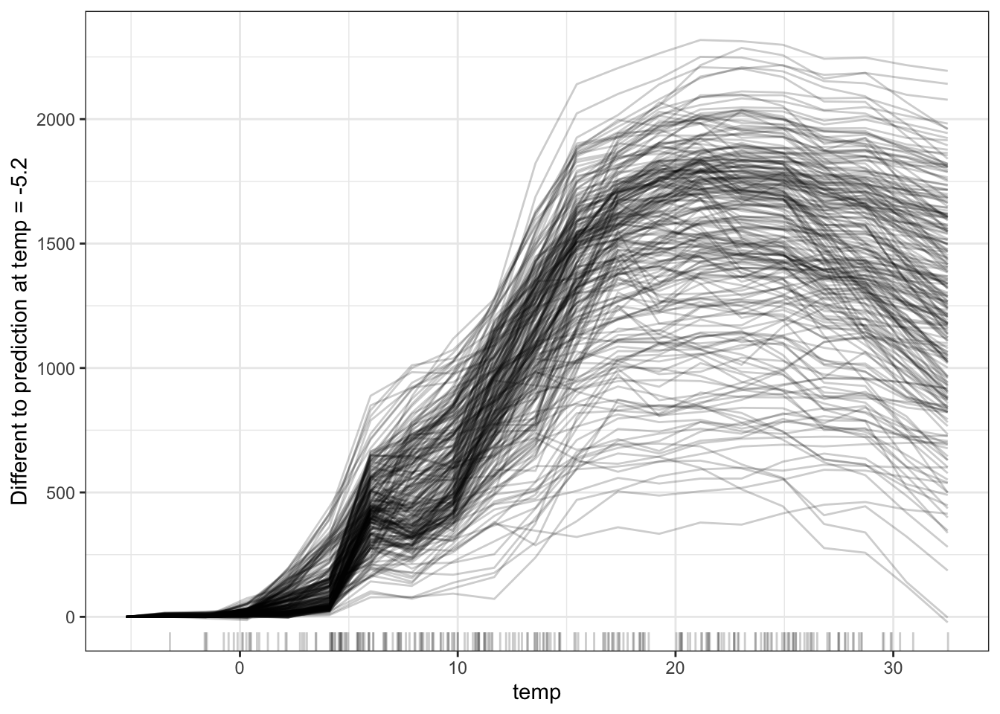

# فصل ۱۳: انتظار شرطی فردی (ICE)

> **عنوان اصلی:** Individual Conditional Expectation (ICE)  
> **منبع:** [https://christophm.github.io/interpretable-ml-book/ice.html](https://christophm.github.io/interpretable-ml-book/ice.html)  
> **نویسنده:** Christoph Molnar  
> **مترجم:** مریم محمودی

---

نمودارهای انتظار شرطی فردی (Individual Conditional Expectation یا ICE) یک خط برای هر نمونه نشان می‌دهند که مشخص می‌کند پیش‌بینی آن نمونه هنگام تغییر یک ویژگی چگونه تغییر می‌کند.

یک نمودار ICE ([Goldstein و همکاران، ۲۰۱۵](appendix-D-references.md)) وابستگی پیش‌بینی به یک ویژگی را برای *هر* نمونه به‌طور جداگانه به تصویر می‌کشد، به‌طوری‌که برای هر نمونهٔ مجموعه داده یک خط به دست می‌آید.
مقادیر یک خط (و یک نمونه) را می‌توان با ثابت نگه‌داشتن همهٔ ویژگی‌های دیگر، ساختن نسخه‌های جدیدی از این نمونه با جایگزینی مقدار آن ویژگی با مقادیری از یک شبکه، و گرفتن پیش‌بینی از مدل جعبه‌سیاه برای این نمونه‌های تازه‌ساخته‌شده، محاسبه کرد.
نتیجه، مجموعه‌ای از نقاط برای یک نمونه است که شامل مقدار ویژگی از شبکه و پیش‌بینی متناظر آن است.
به‌عبارت دیگر، نمودارهای ICE همهٔ [منحنی‌های Ceteris Paribus](#ceteris-paribus) یک مجموعه داده را در یک نمودار واحد نشان می‌دهند.

> **برای درک بهتر (توضیح مترجم):** فرض کنید می‌خواهیم برای یک روز مشخص (نمونهٔ شمارهٔ ۱) خط ICE مربوط به رطوبت را بسازیم. دما، سرعت باد و سایر ویژگی‌های این روز را ثابت نگه می‌داریم و فقط رطوبت را با مقادیر شبکهٔ ۲۰، ۴۰، ۶۰ و ۸۰ درصد جایگزین می‌کنیم. به این ترتیب چهار نسخهٔ ساختگی از همین روز به دست می‌آید و مدل جعبه‌سیاه برای هر کدام یک پیش‌بینی می‌دهد؛ مثلاً ۵۴۰۰، ۵۳۰۰، ۵۱۰۰ و ۴۳۰۰ دوچرخه (این اعداد فرضی‌اند، فقط برای توضیح آمده‌اند و در کتاب وجود ندارند). وصل‌کردن چهار نقطهٔ (۲۰، ۵۴۰۰)، (۴۰، ۵۳۰۰)، (۶۰، ۵۱۰۰) و (۸۰، ۴۳۰۰) به هم، همان خط ICE این روز است. تکرار همین کار برای همهٔ روزهای مجموعه داده، یک خط برای هر روز می‌دهد و مجموع این خط‌ها همان نمودار ICE است.

## مثال‌ها

شکل ۱۳.۱ نمودارهای ICE را برای [پیش‌بینی اجارهٔ دوچرخه](#bike-data) نشان می‌دهد.
مدل پیش‌بینی زیربنایی یک جنگل تصادفی است.
به نظر می‌رسد همهٔ منحنی‌ها روندی مشابه دارند، بنابراین تعامل آشکاری وجود ندارد.

*شکل ۱۳.۱: نمودارهای ICE پیش‌بینی اجارهٔ دوچرخه بر اساس دما، رطوبت و سرعت باد.*

> **توضیح مترجم (متن داخل تصویر):** برچسب‌های محور افقی، از چپ به راست: Temperature = دما، Humidity = رطوبت، Windspeed = سرعت باد. برچسب محور عمودی: Predicted bike rentals = اجارهٔ پیش‌بینی‌شدهٔ دوچرخه.

*شکل ۱۳.۲: منحنی‌های ICE برای جنگل تصادفی پیش‌بینی‌کنندهٔ اجارهٔ دوچرخه. خطوط بر اساس فصل رنگ‌آمیزی شده‌اند. بالای نمودارهای ICE، نمودارهای جعبه‌ای توزیع رطوبت به تفکیک فصل را نشان می‌دهند.*

> **توضیح مترجم (متن داخل تصویر):** برچسب محور افقی: Humidity = رطوبت؛ برچسب محور عمودی: Predicted bike rentals = اجارهٔ پیش‌بینی‌شدهٔ دوچرخه. راهنمای رنگ (season = فصل): WINTER = زمستان، SPRING = بهار، SUMMER = تابستان، FALL = پاییز.
>
> توجه: در تصویر منتشرشده در نسخهٔ وب کتاب، نمودارهای جعبه‌ای‌ای که زیرنویس به آن‌ها اشاره می‌کند (و در متن نیز به آن‌ها ارجاع شده است) دیده نمی‌شوند. زیرنویس و متن همان‌طور که در منبع آمده‌اند ترجمه شده‌اند.

اما می‌توانیم با تغییردادن نمودار ICE، تعامل‌های احتمالی را نیز بررسی کنیم.
شکل ۱۳.۲ دوباره نمودار ICE رطوبت را نشان می‌دهد، با این تفاوت که این بار خطوط بر اساس فصل رنگ‌آمیزی شده‌اند.
این نمودار چند نکته را نشان می‌دهد:
اول -- که جای تعجب ندارد -- فصل‌های مختلف «عرض از مبدأ» متفاوتی دارند.
یعنی، برای مثال، روزهای زمستان پیش‌بینی کمتری دارند و تابستان بیشترین پیش‌بینی را، مستقل از رطوبت.
اما شکل ۱۳.۲ همچنین نشان می‌دهد که اثر رطوبت برای فصل‌های مختلف متفاوت است:
در زمستان، افزایش رطوبت فقط به‌طور جزئی تعداد پیش‌بینی‌شدهٔ اجارهٔ دوچرخه را کاهش می‌دهد.
برای تابستان، اجارهٔ پیش‌بینی‌شدهٔ دوچرخه بین رطوبت نسبی ۲۰٪ تا ۶۰٪ تقریباً ثابت می‌ماند و بالاتر از ۶۰٪ به‌طور قابل توجهی افت می‌کند.
اثرات رطوبت برای بهار و پاییز به نظر می‌رسد ترکیبی از «ثبات زمستان» و «افت تابستان» باشند.
با این حال، همان‌طور که نمودارهای جعبه‌ای در شکل ۱۳.۲ نشان می‌دهند، نباید اثرات رطوبت بسیار پایین را برای تابستان و پاییز بیش از حد تفسیر کنیم.

> **از شفافیت و رنگ استفاده کنید**
>
> اگر خطوط در یک نمودار به‌شدت روی هم قرار می‌گیرند، می‌توانید آن‌ها را کمی شفاف کنید.
> اگر این کار کمکی نکرد، شاید بهتر باشد سراغ [نمودار وابستگی جزئی](#pdp) بروید.
> با رنگ‌آمیزی خطوط بر اساس مقدار یک ویژگی دیگر، می‌توانید تعامل‌ها را بررسی کنید.

> **توضیح مترجم:** در متن اصلی این کادر، جمله به‌صورت «If lines overlap heavily in a boxplot» آمده است. با توجه به مفهوم جمله، منظور نویسنده نمودار ICE (و نه نمودار جعبه‌ای) است؛ به همین دلیل در ترجمه از واژهٔ «نمودار» استفاده شده است.

بیایید به [وظیفهٔ دسته‌بندی پنگوئن‌ها](#penguins) برگردیم و ببینیم پیش‌بینی هر نمونه چگونه با ویژگی `bill_length_mm` (طول منقار) مرتبط است.
جنگل تصادفی‌ای را تحلیل می‌کنیم که احتمال مادگی یک پنگوئن را بر اساس اندازه‌گیری‌های بدنی پیش‌بینی می‌کند.
شکل ۱۳.۳ یک نمودار ICE نسبتاً زشت است.
اما گاهی واقعیت همین است.
دلیل آن این است که مدل برای اکثر پنگوئن‌ها نسبتاً مطمئن است و بین ۰ و ۱ می‌پرد.

*شکل ۱۳.۳: نمودار ICE احتمال پنگوئن گونهٔ Adelie بر اساس طول منقار. هر خط نشان‌دهندهٔ یک پنگوئن است.*

> **توضیح مترجم (متن داخل تصویر):** برچسب محور افقی: Bill length in mm = طول منقار (برحسب میلی‌متر)؛ برچسب محور عمودی: P(female) = احتمال مادگی.
>
> توجه: متن فصل می‌گوید مدل احتمال مادگی (female) پنگوئن را پیش‌بینی می‌کند و محور عمودی تصویر هم P(female) است، اما زیرنویس منبع «P(Adelie)» نوشته است. این ناهماهنگی در منبع وجود دارد؛ زیرنویس مطابق منبع ترجمه شده و اصلاح نشده است.

## نمودار ICE مرکزی‌شده (c-ICE)

نمودارهای ICE با یک مشکل روبه‌رو هستند:
گاهی تشخیص این‌که آیا منحنی‌های ICE به این دلیل بین نقاط داده متفاوت‌اند که از پیش‌بینی‌های متفاوتی شروع می‌شوند، دشوار است.
یک راه‌حل ساده این است که منحنی‌ها را در یک نقطهٔ مشخص از ویژگی مرکزی‌سازی کنیم و فقط تفاوت پیش‌بینی نسبت به آن نقطه را نمایش دهیم.
نموداری که از این کار حاصل می‌شود، نمودار ICE مرکزی‌شده (c-ICE) نامیده می‌شود.
لنگرانداختن منحنی‌ها در انتهای پایینی ویژگی، انتخاب خوبی است.
هر منحنی این‌گونه تعریف می‌شود:

$$ICE^{(i)}\_j(x\_j) = \hat{f}(x\_j, \mathbf{x}^{(i)}\_{-j}) - \hat{f}(a, \mathbf{x}\_{-j}^{(i)})$$

که در آن $\hat{f}$ مدل برازش‌شده و $a$ نقطهٔ لنگر است.

بیایید نگاهی به یک نمودار ICE مرکزی‌شده برای دما در پیش‌بینی اجارهٔ دوچرخه بیندازیم:

*شکل ۱۳.۴: نمودارهای ICE مرکزی‌شدهٔ تعداد پیش‌بینی‌شدهٔ دوچرخه‌ها بر اساس دما. خطوط تفاوت پیش‌بینی را نسبت به پیش‌بینی در حداقل دمای مشاهده‌شده نشان می‌دهند.*

> **توضیح مترجم (متن داخل تصویر):** برچسب محور افقی: temp = دما (نام ویژگی در مجموعه داده). برچسب محور عمودی: «Different to prediction at temp = -5.2» یعنی «تفاوت با پیش‌بینی در دمای ‎-5.2»؛ مقدار ‎-5.2 همان حداقل دمای مشاهده‌شده است که نقطهٔ لنگر $a$ در فرمول بالا را مشخص می‌کند. به همین دلیل همهٔ منحنی‌ها در این نقطه از صفر شروع می‌شوند.

نمودارهای ICE مرکزی‌شده مقایسهٔ منحنی‌های نمونه‌های مختلف را آسان‌تر می‌کنند.
این می‌تواند زمانی مفید باشد که نه به‌دنبال تغییر مطلق یک مقدار پیش‌بینی‌شده، بلکه به‌دنبال تفاوت پیش‌بینی نسبت به یک نقطهٔ ثابت از بازهٔ ویژگی باشیم.

> **برای درک بهتر (توضیح مترجم):** فرض کنید پیش‌بینی مدل برای دو روز، یکی زمستانی و دیگری تابستانی، در چهار دمای شبکه به‌صورت زیر باشد (اعداد فرضی و صرفاً برای توضیح‌اند). نقطهٔ لنگر را حداقل مقدار شبکه، یعنی $a = 0$، می‌گیریم و پیش‌بینی در این نقطه را از همهٔ مقادیر کم می‌کنیم:
>
> | | دما ۰ | دما ۱۰ | دما ۲۰ | دما ۳۰ |
> |---|---|---|---|---|
> | پیش‌بینی روز ۱ (زمستان) | ۲۰۰۰ | ۲۵۰۰ | ۳۰۰۰ | ۲۸۰۰ |
> | پیش‌بینی روز ۲ (تابستان) | ۵۰۰۰ | ۵۵۰۰ | ۶۰۰۰ | ۵۸۰۰ |
> | c-ICE روز ۱ | ۰ | ۵۰۰ | ۱۰۰۰ | ۸۰۰ |
> | c-ICE روز ۲ | ۰ | ۵۰۰ | ۱۰۰۰ | ۸۰۰ |
>
> در نمودار ICE معمولی، دو منحنی با فاصلهٔ ثابت ۳۰۰۰ از هم قرار دارند و تشخیص شکل آن‌ها دشوار است؛ اما در c-ICE هر دو منحنی دقیقاً بر هم منطبق می‌شوند. یعنی اثر دما روی هر دو روز یکسان است و تفاوت آن‌ها فقط در «سطح پایهٔ» پیش‌بینی است. اگر منحنی‌ها پس از مرکزی‌سازی از هم جدا می‌شدند، نشانه‌ای از ناهمگنی (و احتمالاً تعامل) بود.

## نمودار ICE مشتقی (d-ICE)

راه دیگری که می‌تواند تشخیص بصری ناهمگنی را آسان‌تر کند، نگاه‌کردن به مشتقات فردی تابع پیش‌بینی نسبت به یک ویژگی است.
نموداری که از این کار حاصل می‌شود، نمودار ICE مشتقی (d-ICE) نامیده می‌شود.
مشتقات یک تابع (یا منحنی) به شما می‌گویند که آیا تغییری رخ می‌دهد و در چه جهتی رخ می‌دهد.
با نمودار ICE مشتقی، به‌راحتی می‌توان بازه‌هایی از مقادیر ویژگی را یافت که در آن‌ها پیش‌بینی‌های جعبه‌سیاه برای (دست‌کم برخی) نمونه‌ها تغییر می‌کند.
اگر بین ویژگی موردبررسی $X_j$ و سایر ویژگی‌ها $X_{-j}$ تعاملی وجود نداشته باشد، آنگاه تابع پیش‌بینی را می‌توان این‌گونه بیان کرد:

$$\hat{f}(\mathbf{x}) = \hat{f}(x\_j, \mathbf{x}\_C) = g(x\_j) + h(\mathbf{x}\_{-j}), \quad\text{with}\quad\frac{\partial \hat{f}(\mathbf{x})}{\partial x\_j} = g'(x\_j)$$

بدون تعامل، مشتقات جزئی فردی باید برای همهٔ نمونه‌ها یکسان باشند.
اگر متفاوت باشند، به‌دلیل وجود تعامل است و در نمودار d-ICE قابل مشاهده می‌شود.
علاوه بر نمایش منحنی‌های فردی مشتق تابع پیش‌بینی نسبت به ویژگی $j$، نمایش انحراف معیار مشتق نیز کمک می‌کند تا مناطقی از ویژگی $j$ که در آن‌ها ناهمگنی در مشتقات برآوردشده وجود دارد، برجسته شوند.
محاسبهٔ نمودار ICE مشتقی زمان زیادی می‌برد و از نظر عملی چندان کاربردی نیست.

> **برای درک بهتر (توضیح مترجم):** همان دو روز مثال قبل را در نظر بگیرید و مشتق را با تفاضل پیش‌بینی‌ها در هر بازهٔ ۱۰ واحدی دما تقریب بزنید (اعداد فرضی‌اند). برای روز ۱ تفاضل‌ها +۵۰۰، +۵۰۰ و -۲۰۰ و برای روز ۲ نیز دقیقاً +۵۰۰، +۵۰۰ و -۲۰۰ است؛ یعنی مشتق‌ها یکسان‌اند و این با نبود تعامل سازگار است. حال فرض کنید پیش‌بینی‌های روز ۲ به‌جای آن ۵۰۰۰، ۵۵۰۰، ۶۶۰۰ و ۵۸۰۰ بود. تفاضل‌ها +۵۰۰، +۱۱۰۰ و -۸۰۰ می‌شدند و در بازهٔ دمای ۱۰ تا ۲۰ با روز ۱ (+۵۰۰) تفاوت داشتند. نمودار d-ICE دقیقاً همین بازه‌ها را برجسته می‌کند و نشان می‌دهد اثر دما روی روز ۲ با روز ۱ فرق دارد، یعنی بین دما و دیگر ویژگی‌ها تعامل وجود دارد.

## نقاط قوت

منحنی‌های انتظار شرطی فردی **درک‌شان بدیهی و آسان است**.
هر خط، پیش‌بینی‌های یک نمونه را هنگام تغییر ویژگی موردنظر نشان می‌دهد.

منحنی‌های ICE می‌توانند **روابط ناهمگن را آشکار کنند**.

## محدودیت‌ها

منحنی‌های ICE **تنها می‌توانند یک ویژگی را به‌طور معنادار نمایش دهند**، چون نمایش دو ویژگی نیازمند رسم چند سطح روی‌هم‌قرارگرفته خواهد بود و در نمودار چیزی قابل مشاهده نخواهد بود.

منحنی‌های ICE از مشکل همبستگی رنج می‌برند: اگر ویژگی موردنظر با سایر ویژگی‌ها همبسته باشد، **برخی نقاط روی خطوط ممکن است بر اساس توزیع مشترک ویژگی‌ها، نقاط داده نامعتبری باشند**.

> **توضیح مترجم:** برای مثال، اگر ویژگی موردنظر «دما» باشد و دما با «فصل» همبسته باشد، ساختن نسخه‌ای از یک روز زمستانی با دمای ۳۵ درجهٔ سانتی‌گراد نقطه‌ای می‌سازد که در واقعیت (تقریباً) هرگز دیده نمی‌شود. مدل برای چنین نقطه‌ای بیرون از دادهٔ آموزشی پیش‌بینی می‌کند و بخشی از خط ICE بر پایهٔ پیش‌بینی‌های غیرقابل‌اعتماد رسم می‌شود. نوار کوتاه (rug) زیر نمودارها در شکل‌های این فصل نشان می‌دهد مقادیر مشاهده‌شدهٔ ویژگی در کجا متراکم‌اند و می‌تواند به شناسایی چنین نواحی کمک کند.

اگر تعداد زیادی منحنی ICE رسم شود، **نمودار می‌تواند شلوغ شود** و چیزی قابل مشاهده نخواهد بود.
راه‌حل: یا به خطوط کمی شفافیت اضافه کنید یا فقط نمونه‌ای از خطوط را رسم کنید.

در نمودارهای ICE ممکن است **دیدن میانگین کار آسانی نباشد**.
این مشکل راه‌حل ساده‌ای دارد:
منحنی‌های انتظار شرطی فردی را با [نمودار وابستگی جزئی](#pdp) ترکیب کنید.

## نرم‌افزار و جایگزین‌ها

نمودارهای ICE در بسته‌های R به نام‌های `iml` ([Molnar، Bischl و Casalicchio، ۲۰۱۸](appendix-D-references.md)) (که برای این مثال‌ها استفاده شده)، `ICEbox` و `pdp` پیاده‌سازی شده‌اند.
بستهٔ دیگر R به نام `condvis` نیز کاری بسیار مشابه ICE انجام می‌دهد.
در Python، می‌توانید از [PiML](https://selfexplainml.github.io/PiML-Toolbox/_build/html/index.html) ([Sudjianto و همکاران، ۲۰۲۳](appendix-D-references.md)) استفاده کنید.
