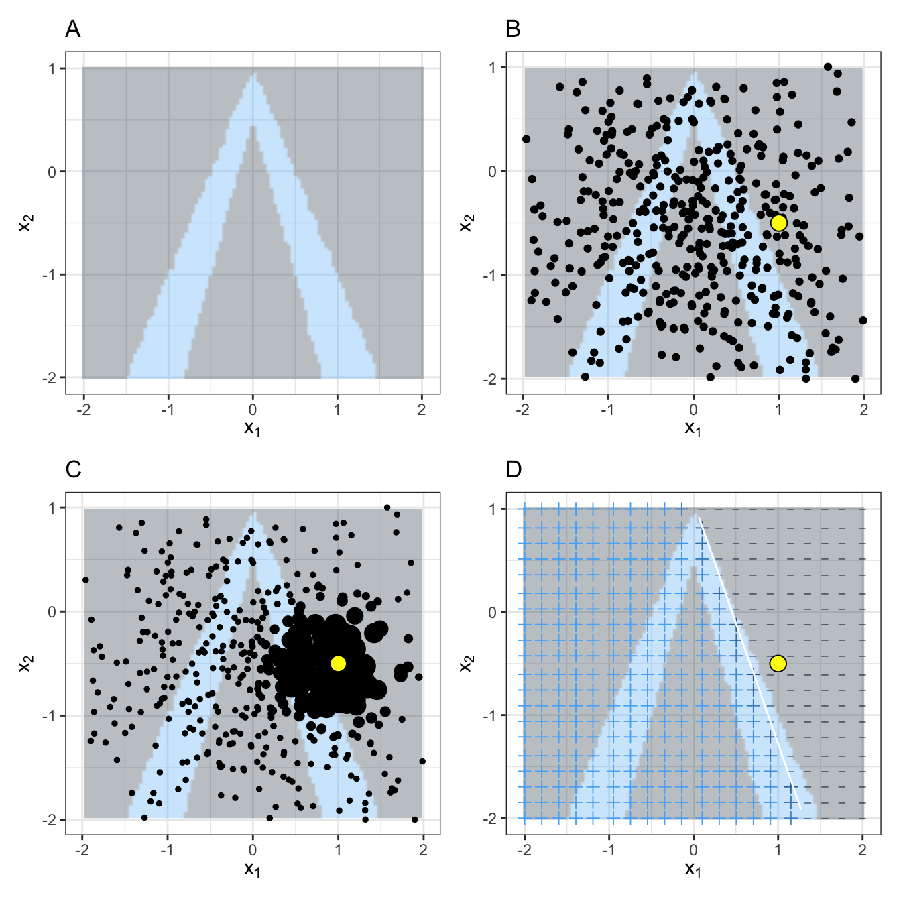
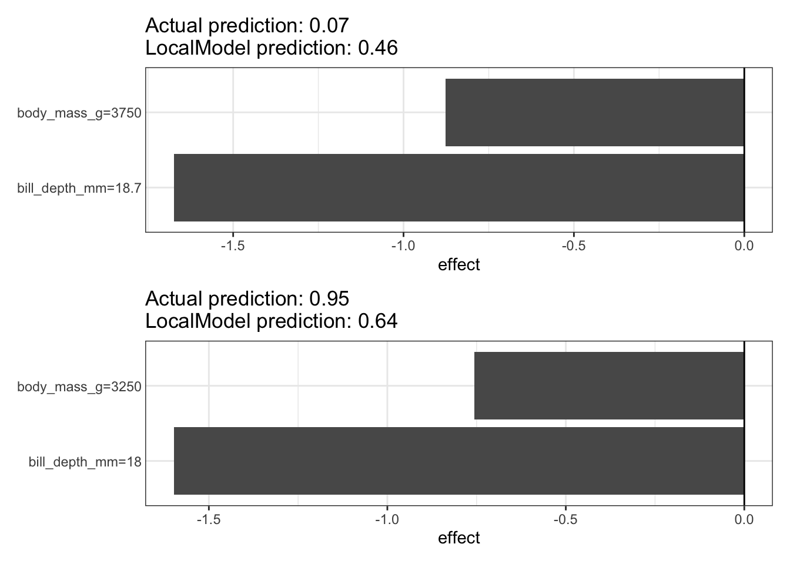

# فصل ۱۴: LIME

> **عنوان اصلی:** LIME  
> **منبع:** [https://christophm.github.io/interpretable-ml-book/lime.html](https://christophm.github.io/interpretable-ml-book/lime.html)  
> **نویسنده:** Christoph Molnar  
> **مترجم:** مریم محمودی

---

مدل‌های جانشین محلی (Local Surrogate Models) مدل‌هایی تفسیرپذیر هستند که برای توضیح پیش‌بینی‌های فردیِ مدل‌های یادگیری ماشین جعبه‌سیاه به کار می‌روند.
توضیحات محلی تفسیرپذیر مستقل از مدل (Local Interpretable Model-agnostic Explanations یا LIME)، که [Ribeiro و همکاران (۲۰۱۶)](appendix-D-references.md) آن را پیشنهاد کرده‌اند، رویکردی برای برازش مدل‌های جانشین است.
مدل‌های جانشین آموزش داده می‌شوند تا پیش‌بینی‌های مدل جعبه‌سیاهِ زیربنایی را تقریب بزنند.

> **توضیح مترجم:** در این فصل «مدل جانشین» (surrogate model) به مدلی ساده و تفسیرپذیر گفته می‌شود که به‌جای مدل جعبه‌سیاه، رفتار آن را تقلید می‌کند. «محلی» (local) یعنی این تقلید فقط در اطراف یک نمونهٔ مشخص مدنظر است، نه در کل فضای ورودی؛ فصل [مدل‌های جایگزین](25-surrogate.md) حالت سراسری (global) همین ایده را شرح می‌دهد.

ایده بسیار شهودی است.
ابتدا داده‌های آموزشی را فراموش کنید و تصور کنید فقط خودِ مدل جعبه‌سیاه را در اختیار دارید، که می‌توانید به آن نقاط داده‌ای بدهید و پیش‌بینی‌های مدل را بگیرید.
هر چند بار که بخواهید می‌توانید جعبه را بیازمایید.
هدف شما این است که بفهمید چرا مدل یادگیری ماشین یک پیش‌بینی مشخص را انجام داده است.
LIME آزمایش می‌کند وقتی گونه‌های مختلفی از داده‌های شما را به مدل یادگیری ماشین می‌دهید، پیش‌بینی‌ها چه می‌شوند.
LIME یک مجموعه داده جدید تولید می‌کند که از نمونه‌های اختلال‌یافته (perturbed) و پیش‌بینی‌های متناظر مدل جعبه‌سیاه تشکیل شده است.
سپس LIME روی این مجموعه داده جدید یک مدل تفسیرپذیر آموزش می‌دهد که بر اساس نزدیکیِ نمونه‌های تولیدشده به نمونهٔ مورد نظر وزن‌دهی شده است.
مدل تفسیرپذیر می‌تواند هر چیزی از [Lasso](06-linear-regression.md#لاسو-lasso) تا [درخت تصمیم](09-decision-tree.md) باشد.
مدل آموخته‌شده باید پیش‌بینی‌های مدل یادگیری ماشین را به‌صورت محلی به‌خوبی تقریب بزند، اما لازم نیست تقریب سراسری خوبی باشد.
این نوع دقت را وفاداری محلی (local fidelity) نیز می‌نامند.

از نظر ریاضی، مدل‌های جانشین محلی با قید تفسیرپذیری را می‌توان به‌صورت زیر بیان کرد:

$$\text{explanation}(\mathbf{x}) = \arg\min\_{g \in G} L(\hat{f},g,\pi\_{\mathbf{x}}) + \Omega(g)$$

مدل توضیح‌دهنده برای نمونهٔ $\mathbf{x}$، مدل $g$ است (مثلاً یک مدل رگرسیون خطی) که تابع زیان $L$ (مثلاً میانگین مربعات خطا) را کمینه می‌کند؛ این تابع زیان اندازه می‌گیرد که توضیح تا چه حد به پیش‌بینی مدل اصلی $\hat{f}$ (مثلاً یک مدل xgboost) نزدیک است، در حالی که پیچیدگی مدل $\Omega(g)$ پایین نگه داشته می‌شود (مثلاً ترجیح ویژگی‌های کمتر).
$G$ خانوادهٔ توضیحات ممکن است، برای مثال همهٔ مدل‌های رگرسیون خطی ممکن.
معیار مجاورت $\pi\_{\mathbf{x}}$ مشخص می‌کند همسایگی پیرامون نمونهٔ $\mathbf{x}$ که برای توضیح در نظر می‌گیریم چقدر بزرگ است.
در عمل، LIME فقط بخش زیان را بهینه می‌کند.
کاربر باید پیچیدگی را تعیین کند، مثلاً با انتخاب حداکثر تعداد ویژگی‌هایی که مدل رگرسیون خطی مجاز به استفاده از آن‌هاست.

دستورالعمل آموزش مدل‌های جانشین محلی:

- نمونهٔ مورد نظر خود را که می‌خواهید توضیحی برای پیش‌بینی جعبه‌سیاه آن داشته باشید انتخاب کنید.
- مجموعه داده خود را اختلال دهید (perturb) و پیش‌بینی‌های جعبه‌سیاه را برای این نقاط جدید به دست آورید.
- نمونه‌های جدید را بر اساس نزدیکی‌شان به نمونهٔ مورد نظر وزن‌دهی کنید.
- یک مدل تفسیرپذیرِ وزن‌دار روی مجموعه داده‌ای که شامل گونه‌هاست آموزش دهید.
- پیش‌بینی را با تفسیر مدل محلی توضیح دهید.

در پیاده‌سازی‌های فعلی در [R](https://github.com/thomasp85/lime) و [Python](https://github.com/marcotcr/lime)، برای مثال، می‌توان رگرسیون خطی را به‌عنوان مدل جانشین تفسیرپذیر برگزید.
از پیش باید $K$ را انتخاب کنید، یعنی تعداد ویژگی‌هایی که می‌خواهید در مدل تفسیرپذیر شما باشد.
هرچه $K$ کمتر باشد، تفسیر مدل آسان‌تر است.
$K$ بزرگ‌تر به‌طور بالقوه مدل‌هایی با وفاداری بالاتر تولید می‌کند.
روش‌های متعددی برای آموزش مدل‌هایی با دقیقاً $K$ ویژگی وجود دارد.
انتخاب خوب، [Lasso](06-linear-regression.md#لاسو-lasso) است.
یک مدل Lasso با پارامتر منظم‌سازی $\lambda$ بزرگ، مدلی بدون هیچ ویژگی به دست می‌دهد.
با آموزش مجدد مدل‌های Lasso و کاهش تدریجی $\lambda$، یکی پس از دیگری، ویژگی‌ها برآوردهای وزنی پیدا می‌کنند که با صفر تفاوت دارد.
اگر در مدل $K$ ویژگی وجود داشته باشد، به تعداد ویژگی مطلوب رسیده‌اید.
راهبردهای دیگر، انتخاب پیشروی (forward) یا پسروی (backward) ویژگی‌هاست.
یعنی یا از مدل کامل (= شامل همهٔ ویژگی‌ها) شروع می‌کنید یا از مدلی که فقط عرض از مبدأ دارد، و سپس آزمون می‌کنید که افزودن یا حذف کدام ویژگی بیشترین بهبود را می‌آورد، تا زمانی که به مدلی با $K$ ویژگی برسید.

> **برای درک بهتر (توضیح مترجم):** فرض کنید می‌خواهیم $K=2$ ویژگی داشته باشیم و مدل محلی روی چهار ویژگی (دما، رطوبت، باد، فشار) برازش می‌شود. با $\lambda$ خیلی بزرگ همهٔ ضرایب صفرند. $\lambda$ را کم‌کم کم می‌کنیم؛ ابتدا ضریب دما از صفر جدا می‌شود (۱ ویژگی)، کمی بعد ضریب رطوبت (۲ ویژگی). همین‌جا متوقف می‌شویم، چون $K=2$ ویژگی با ضریب غیرصفر داریم. (مثال فرضی و صرفاً برای توضیح است و در کتاب وجود ندارد.)

چگونه گونه‌های داده را به دست می‌آورید؟
این به نوع داده بستگی دارد، که می‌تواند متن، تصویر یا داده جدولی باشد.
برای متن و تصویر، راه‌حل این است که کلمه‌های منفرد یا ابرپیکسل‌ها (super-pixels) را روشن یا خاموش کنیم.
در مورد داده جدولی، LIME نمونه‌های جدید را با اختلال دادن به هر ویژگی به‌طور جداگانه می‌سازد، به این صورت که از یک توزیع نرمال نمونه می‌گیرد که میانگین و انحراف معیارش از همان ویژگی گرفته شده است.

## LIME برای داده‌های جدولی

داده جدولی، داده‌ای است که در قالب جدول می‌آید و هر سطر یک نمونه و هر ستون یک ویژگی را نشان می‌دهد.
نمونه‌های LIME پیرامون نمونهٔ مورد نظر گرفته نمی‌شوند، بلکه از مرکز جرم (mass center) داده‌های آموزشی گرفته می‌شوند، که مسئله‌ساز است.
اما این کار احتمال اینکه نتیجهٔ پیش‌بینی برخی از نقاط نمونه با نقطهٔ داده مورد نظر متفاوت باشد را افزایش می‌دهد، و اینکه LIME دست‌کم بتواند مقداری توضیح بیاموزد.
شکل ۱۴.۱ به‌صورت بصری توضیح می‌دهد که نمونه‌گیری و آموزش مدل محلی چگونه کار می‌کند:

*شکل ۱۴.۱: الگوریتم LIME برای داده جدولی. الف) سطح پیش‌بینی بر حسب ویژگی‌های $x\_1$ و $x\_2$. کلاس‌های پیش‌بینی‌شده: ۱ (تیره) یا ۰ (روشن). ب) نمونهٔ مورد نظر (نقطهٔ بزرگ) و داده‌های نمونه‌گیری‌شده (نقطه‌های کوچک). ج) اختصاص وزن‌ها بر اساس فاصله تا نمونهٔ مورد نظر. د) علامت‌های (+/−) طبقه‌بندی‌های مدل آموخته‌شدهٔ محلی را از نمونه‌های وزن‌دار نشان می‌دهند. خط سفید مرز تصمیم ($P(c=1) = 0.5$) را مشخص می‌کند.*

> **توضیح مترجم (متن داخل تصویر):** تنها متن‌های داخل تصویر عبارت‌اند از عنوان چهار پنل (A تا D = الف تا د) و برچسب محورها ($x\_1$ و $x\_2$)، که نماد ریاضی‌اند و ترجمه نمی‌شوند. در پنل الف ناحیهٔ آبی روشن کلاس ۰ و ناحیهٔ خاکستری تیره کلاس ۱ است؛ در پنل ب نقطهٔ زرد نمونهٔ مورد نظر است؛ در پنل ج اندازهٔ نقطه‌ها نشان‌دهندهٔ وزن (نزدیکی به نمونهٔ مورد نظر) است؛ و در پنل د علامت «+» و «−» پیش‌بینی طبقه‌بندی مدل محلی (خط سفید) را نشان می‌دهد.

همان‌طور که همیشه، شیطان در جزئیات است.
تعریف یک همسایگی معنادار پیرامون یک نقطه دشوار است.
LIME در حال حاضر از یک کرنل هموارساز نمایی (exponential smoothing kernel) برای تعریف همسایگی استفاده می‌کند.
کرنل هموارساز تابعی است که دو نمونهٔ داده می‌گیرد و یک معیار مجاورت برمی‌گرداند.
پهنای کرنل (kernel width) تعیین می‌کند همسایگی چقدر بزرگ باشد:
پهنای کرنل کوچک یعنی یک نمونه باید بسیار نزدیک باشد تا بر مدل محلی اثر بگذارد؛ پهنای کرنل بزرگ‌تر یعنی نمونه‌هایی که دورترند نیز بر مدل اثر می‌گذارند.
اگر به [پیاده‌سازی Python برای LIME (فایل lime/lime_tabular.py)](https://github.com/marcotcr/lime/tree/ce2db6f20f47c3330beb107bb17fd25840ca4606) نگاه کنید، خواهید دید که از یک کرنل هموارساز نمایی (روی داده‌های نرمال‌شده) استفاده می‌کند و پهنای کرنل برابر ۰٫۷۵ برابرِ جذر تعداد ستون‌های داده‌های آموزشی است.
این شبیه یک خط کد بی‌گناه به نظر می‌رسد، اما فیلی است که در اتاق نشیمن شما، کنار ظروف چینی خوبی که از پدربزرگ و مادربزرگتان گرفته‌اید، نشسته است.
مشکل بزرگ این است که راه خوبی برای یافتن بهترین کرنل یا پهنا نداریم.
و اصلاً عدد ۰٫۷۵ از کجا آمده است؟
در برخی سناریوها، می‌توانید با تغییر پهنای کرنل توضیح خود را به‌راحتی وارونه کنید، همان‌طور که در شکل ۱۴.۲ نشان داده شده است:
مدل رگرسیون خطی حاصل به پهنای کرنل بستگی دارد.
آیا اثر محلی «حقیقی» ویژگی برای $x = 1.6$ باید منفی باشد، مثبت باشد، یا اثری نداشته باشد؟

> **توضیح مترجم:** عبارت «elephant in the room» در انگلیسی اصطلاحی است برای مسئلهٔ بزرگ و آشکاری که همه از آن چشم می‌پوشند. نویسنده با تصویر طنزآمیز «فیلی در اتاق نشیمن، کنار ظروف چینی گران‌بها» می‌گوید این خط کد ساده در واقع حساس و پرخطر است؛ چون هر تغییری در آن می‌تواند توضیح را به‌کلی عوض کند.

*شکل ۱۴.۲: توضیح پیش‌بینی نمونهٔ $x = 1.6$ با پهنای کرنل‌های مختلف. پیش‌بینی‌های مدل با خط ضخیم نشان داده شده‌اند و توزیع داده‌ها با علامت‌های کوتاه روی محور افقی (rug) نمایش داده شده است. سه مدل جانشین محلی با پهنای کرنل‌های متفاوت محاسبه شده‌اند.*

> **توضیح مترجم (متن داخل تصویر):** برچسب محور افقی: x. برچسب محور عمودی: Black Box prediction = پیش‌بینی جعبه‌سیاه. عنوان راهنما: Kernel width = پهنای کرنل، با سه مقدار ۰٫۱ (خط ممتد تیره)، ۰٫۷۵ (نقطه‌چین سبز) و ۲ (خط‌چین زرد). علامت «X» روی منحنی، نمونهٔ مورد توضیح ($x = 1.6$) را نشان می‌دهد. همان‌طور که در تصویر دیده می‌شود، شیب خط محلی برای پهنای ۰٫۱ منفی، برای ۰٫۷۵ تقریباً صفر و برای ۲ مثبت است.

این مثال فقط یک ویژگی را نشان می‌دهد.
در فضاهای ویژگیِ با ابعاد بالا بدتر می‌شود.
همچنین بسیار نامشخص است که آیا معیار فاصله باید با همهٔ ویژگی‌ها یکسان رفتار کند.
آیا یک واحد فاصله برای ویژگی $X\_1$ با یک واحد برای ویژگی $X\_2$ یکسان است؟
معیارهای فاصله کاملاً دلخواه هستند و فاصله‌ها در ابعاد (یعنی ویژگی‌های) مختلف ممکن است اصلاً قابل مقایسه نباشند.

بیایید یک مثال عینی را ببینیم.
به [داده‌های پنگوئن](05-data.md) برمی‌گردیم که دربارهٔ دسته‌بندی یک پنگوئن به ماده یا نر بر اساس اندازه‌گیری‌های بدن است.
جنگل تصادفی‌ای را که برای این کار آموزش دیده تحلیل می‌کنیم.
توضیحات با ۲ ویژگی ساخته شده‌اند.
نتایج مدل‌های خطی محلیِ تُنک (sparse) که برای دو نمونه با کلاس‌های پیش‌بینی‌شدهٔ متفاوت آموزش دیده‌اند در شکل ۱۴.۳ نشان داده شده است.
در اینجا، جرم بدنی بیشتر و منقار بلندتر با P(ماده) کمتر مرتبط‌اند.

*شکل ۱۴.۳: توضیحات LIME برای دو نمونه از مجموعه داده پنگوئن. محور افقی اثر ویژگی را نشان می‌دهد که برابر وزن ضربدر مقدار واقعی ویژگی است.*

> **توضیح مترجم (متن داخل تصویر):** عنوان هر پنل: Actual prediction = پیش‌بینی واقعیِ جنگل تصادفی (پنل بالا ۰٫۰۷، پنل پایین ۰٫۹۵)؛ LocalModel prediction = پیش‌بینی مدل محلی (پنل بالا ۰٫۴۶، پنل پایین ۰٫۶۴). برچسب محور افقی: effect = اثر. برچسب میله‌ها: body\_mass\_g = جرم بدن (گرم) و bill\_depth\_mm = عمق منقار (میلی‌متر) به همراه مقدار آن ویژگی برای نمونه (پنل بالا: ۳۷۵۰ و ۱۸٫۷؛ پنل پایین: ۳۲۵۰ و ۱۸).
>
> توجه: متن منبع می‌گوید «جرم بدنی بیشتر و منقار بلندتر»، در حالی که ویژگی دوم در تصویر عمق منقار (bill\_depth\_mm) است، نه طول منقار. همچنین پیوند «داده‌های پنگوئن» در متن اصلی به بخش داده‌های دوچرخه (#bike-data) اشاره می‌کند. ترجمه عیناً از متن منبع پیروی کرده است و در اینجا فقط ناهماهنگی گزارش می‌شود.

## LIME برای داده‌های متنی

LIME برای متن با LIME برای داده جدولی تفاوت دارد.
گونه‌های داده به شکل متفاوتی تولید می‌شوند:
با شروع از متن اصلی، متن‌های جدید با حذف تصادفی کلمه‌ها از متن اصلی ساخته می‌شوند.
مجموعه داده با ویژگی‌های دودویی برای هر کلمه نمایش داده می‌شود.
اگر کلمهٔ متناظر در متن گنجانده شده باشد، ویژگی ۱ و اگر حذف شده باشد ۰ است.
