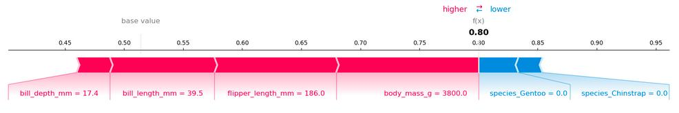
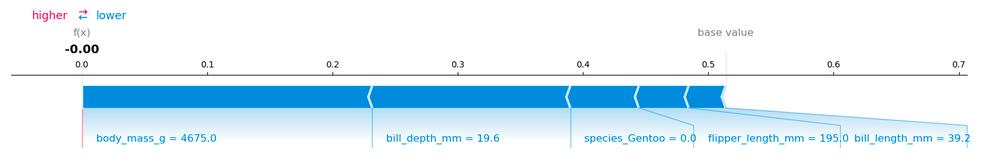

# فصل ۱۸: شپ (SHAP)

> **عنوان اصلی:** SHAP  
> **منبع:** [https://christophm.github.io/interpretable-ml-book/shap.html](https://christophm.github.io/interpretable-ml-book/shap.html)  
> **نویسنده:** Christoph Molnar  
> **مترجم:** مریم محمودی

---

SHAP (SHapley Additive exPlanations)، که [Lundberg و Lee (۲۰۱۷)](appendix-D-references.md) آن را معرفی کردند، روشی برای توضیح پیش‌بینی‌های منفرد است.
SHAP بر پایهٔ مقادیر شپلیِ بهینه از دیدگاه نظریهٔ بازی‌ها (game-theoretically optimal Shapley values) بنا شده است.
توصیه می‌کنم ابتدا فصل [مقادیر شپلی](17-shapley.md) را بخوانید.

برای اینکه بفهمیم چرا SHAP چیزی مستقل است و فقط امتدادی از فصل [مقادیر شپلی](17-shapley.md) نیست، کمی تاریخچه لازم است:
در سال ۱۹۵۳ لوید شپلی (Lloyd Shapley) مفهوم مقادیر شپلی را برای نظریهٔ بازی‌ها معرفی کرد.
استفاده از مقادیر شپلی برای توضیح پیش‌بینی‌های یادگیری ماشین نخستین بار توسط [Štrumbelj و Kononenko (۲۰۱۱)](appendix-D-references.md) و [Štrumbelj و Kononenko (۲۰۱۴)](appendix-D-references.md) پیشنهاد شد.
با این حال، این پیشنهادها چندان محبوب نشدند.
چند سال بعد، [Lundberg و Lee (۲۰۱۷)](appendix-D-references.md) SHAP را پیشنهاد دادند که در اصل روشی تازه برای تخمین مقادیر شپلی به‌منظور تفسیر پیش‌بینی‌های یادگیری ماشین بود، همراه با نظریه‌ای که مقادیر شپلی را به [LIME](14-lime.md) و دیگر روش‌های انتساب پسینی (post-hoc attribution methods) پیوند می‌دهد، و اندکی نظریهٔ اضافه دربارهٔ مقادیر شپلی.

> **توضیح مترجم:** در این فصل *روش انتساب* (attribution method) روشی است که سهم هر ویژگی را در یک پیش‌بینی تعیین می‌کند، و *پسینی* (post-hoc) یعنی پس از آموزش مدل و بدون تغییر در آن اعمال می‌شود. نام SHAP مخفف SHapley Additive exPlanations است و در متن به‌صورت Latin نوشته می‌شود؛ منظور از «مقدار شپلی» همان Shapley value است.

ممکن است بگویید SHAP تنها نام‌گذاری مجدد (rebranding) مقادیر شپلی است (که درست است)، اما این نگاه این واقعیت را نادیده می‌گیرد که SHAP نشان‌دهندهٔ تغییری در محبوبیت و کاربرد مقادیر شپلی هم بود و راه‌های تازه‌ای برای تخمین مقادیر شپلی و تجمیع آن‌ها به شیوه‌های جدید معرفی کرد.
همچنین SHAP مقادیر شپلی را به مدل‌های متنی و تصویری آورد.

این فصل می‌توانست به‌راحتی زیرفصلی از فصل مقادیر شپلی باشد، اما می‌توانید آن را «مقادیر شپلی ۲٫۰» برای تفسیر مدل‌های یادگیری ماشین نیز ببینید.
تأکید این فصل بر راه‌های تازهٔ تخمین مقادیر شپلی و انواع جدید نمودارهاست.
اما پیش از آن، کمی نظریه.

> 💡 **کتابی دربارهٔ SHAP**
>
> به دنبال راهنمایی جامع و عملی برای SHAP و مقادیر شپلی هستید؟
> کتاب [Interpreting Machine Learning Models with SHAP](https://leanpub.com/shap) پاسخگوی نیاز شماست.
> با مثال‌های عملی پایتون از بستهٔ `shap`، یاد می‌گیرید چگونه مدل‌هایی از ساده تا پیچیده را توضیح دهید.
> این کتاب به سازوکار درونی SHAP می‌پردازد، قالب‌هایی برای تفسیر ارائه می‌دهد و محدودیت‌های کلیدی را برجسته می‌کند و بینش‌هایی را که برای به‌کارگیری مطمئن و مؤثر SHAP لازم دارید در اختیار شما می‌گذارد.
>
> 

## نظریهٔ SHAP

هدف SHAP توضیح پیش‌بینی یک نمونه $\mathbf{x}$ از طریق محاسبهٔ سهم هر ویژگی در پیش‌بینی است.
SHAP مقادیر شپلی را از نظریهٔ بازی‌های ائتلافی محاسبه می‌کند، همان‌طور که در [فصل مقادیر شپلی](17-shapley.md) بحث کردیم.
مقادیر ویژگیِ یک نمونهٔ داده نقش بازیکنان را در یک ائتلاف دارند.
مقادیر شپلی به ما می‌گویند «پرداخت» (= پیش‌بینی) را چگونه به‌طور منصفانه میان ویژگی‌ها توزیع کنیم.
یک بازیکن می‌تواند یک مقدار ویژگی منفرد باشد، مثلاً برای داده‌های جدولی.
یک بازیکن می‌تواند گروهی از مقادیر ویژگی هم باشد.
برای نمونه، برای توضیح یک تصویر می‌توان پیکسل‌ها را در ابرپیکسل‌ها (superpixels) گروه‌بندی کرد و پیش‌بینی را میان آن‌ها توزیع کرد.
یکی از نوآوری‌هایی که SHAP به همراه می‌آورد این است که توضیح مبتنی بر مقدار شپلی به‌صورت یک روش انتساب ویژگی افزایشی (additive feature attribution method)، یعنی یک مدل خطی، نمایش داده می‌شود.
این دیدگاه LIME و مقادیر شپلی را به هم متصل می‌کند.
SHAP توضیح را این‌گونه مشخص می‌کند:

$$g(\mathbf{z}')=\phi\_0+\sum\_{j=1}^M\phi\_j z\_j'$$

که در آن $g$ مدل توضیح‌دهنده، $\mathbf{z}' = (z\_1', \ldots, z\_M')^T \in \{0,1\}^M$ بردار ائتلاف (coalition vector)، $M$ بیشینهٔ اندازهٔ ائتلاف و $\phi\_j \in \mathbb{R}$ انتساب ویژگی $j$ است، یعنی همان مقادیر شپلی.
آنچه من «بردار ائتلاف» می‌نامم در مقالهٔ SHAP «ویژگی‌های ساده‌شده» (simplified features) نامیده می‌شود.
گمان می‌کنم این نام از آن رو انتخاب شد که مثلاً برای داده‌های تصویری، تصاویر در سطح پیکسل نمایش داده نمی‌شوند بلکه در ابرپیکسل‌ها تجمیع می‌شوند.
مفید است به $\mathbf{z}'$ به‌عنوان توصیف‌کنندهٔ ائتلاف‌ها فکر کنید: در بردار ائتلاف، مقدار ۱ یعنی مقدار ویژگیِ متناظر «حاضر» (present) و مقدار ۰ یعنی «غایب» (absent) است.
اما باز هم تأکید می‌کنم که «ویژگی» در اینجا می‌تواند با ویژگی‌هایی که مدل به کار برده تفاوت داشته باشد، مثل ابرپیکسل‌ها به‌جای پیکسل‌ها.
نکتهٔ مهم این است که بتوانیم میان این دو نمایش نگاشت داشته باشیم.
برای محاسبهٔ مقادیر شپلی، شبیه‌سازی می‌کنیم که فقط برخی مقادیر ویژگی در بازی شرکت دارند («حاضر») و برخی ندارند («غایب»).
نمایش به‌صورت مدل خطیِ ائتلاف‌ها ترفندی برای محاسبهٔ $\phi\_j$ها است.
برای $\mathbf{x}$، نمونهٔ مورد نظر، بردار ائتلاف $\mathbf{x}'$ برداری از همهٔ ۱‌هاست، یعنی همهٔ مقادیر ویژگی «حاضر» هستند.
فرمول ساده می‌شود به:

$$g(\mathbf{x}')=\phi\_0+\sum\_{j=1}^M\phi\_j$$

این فرمول را با نمادگذاری مشابه در فصل [مقدار شپلی](17-shapley.md) می‌یابید.
دربارهٔ تخمین واقعی در ادامهٔ این فصل بیشتر خواهد آمد.
پیش از ورود به جزئیات تخمین، ابتدا دربارهٔ ویژگی‌های $\phi$ها صحبت کنیم.

مقادیر شپلی تنها راه‌حلی هستند که ویژگی‌های کارایی (Efficiency)، تقارن (Symmetry)، بازیکن ساکت (Dummy) و جمع‌پذیری (Additivity) را برآورده می‌کنند.
SHAP نیز چون مقادیر شپلی را محاسبه می‌کند، این ویژگی‌ها را برآورده می‌کند.
در مقالهٔ SHAP از [Lundberg و Lee (۲۰۱۷)](appendix-D-references.md) ناهمخوانی‌هایی میان ویژگی‌های SHAP و ویژگی‌های شپلی می‌یابید.
SHAP سه ویژگی مطلوب زیر را توصیف می‌کند:

**۱) دقت محلی (Local accuracy)**

$$\hat{f}(\mathbf{x})=g(\mathbf{x}')=\phi\_0+\sum\_{j=1}^M\phi\_j x\_j'$$

اگر $\phi\_0=\mathbb{E}[\hat{f}(X)]$ تعریف کنید و همهٔ $x\_j'$ را برابر ۱ بگذارید، این همان ویژگی کارایی شپلی است.
فقط با نامی دیگر و با استفاده از بردار ائتلاف.

$$\hat{f}(\mathbf{x}) = \phi\_0 + \sum\_{j=1}^M \phi\_j x\_j' = \mathbb{E}[\hat{f}(X)] + \sum\_{j=1}^M\phi\_j$$

**۲) غیاب (Missingness)**

$$x\_j'=0 \Rightarrow \phi\_j=0$$

ویژگی غیاب می‌گوید ویژگیِ غایب انتساب صفر می‌گیرد.
توجه کنید که $x\_j'$ به ائتلاف‌ها اشاره دارد که در آن‌ها مقدار ۰ نشان‌دهندهٔ غیاب یک مقدار ویژگی است.
در نمادگذاری ائتلاف، همهٔ مقادیر ویژگی $x\_j'$ نمونه‌ای که باید توضیح داده شود باید «۱» باشند.
این ویژگی جزو ویژگی‌های مقادیر شپلیِ «معمولی» نیست.
پس چرا برای SHAP به آن نیاز داریم؟
Lundberg آن را [«ویژگی حسابداری جزئی» (minor book-keeping property)](https://github.com/slundberg/shap/issues/175#issuecomment-407134438) می‌نامد.
یک ویژگی غایب می‌تواند -- در نظر -- مقدار شپلی دلخواهی داشته باشد بی‌آنکه به ویژگی دقت محلی آسیبی بزند، زیرا در $x\_j'=0$ ضرب می‌شود.
ویژگی غیاب تضمین می‌کند ویژگی‌های غایب مقدار شپلی ۰ بگیرند.
در عمل، این فقط برای ویژگی‌هایی که ثابت هستند اهمیت دارد.

**۳) سازگاری (Consistency)**

فرض کنید $\hat{f}\_\mathbf{x}(\mathbf{z}') = \hat{f}(h\_\mathbf{x}(\mathbf{z}'))$ و $\mathbf{z}\_{-j}'$ نشان دهد که $z\_j'=0$.
برای هر دو مدل $\hat{f}$ و $\hat{f}'$ که در شرط زیر صدق کنند:

$$\hat{f}\_\mathbf{x}^{\prime}(\mathbf{z}') - \hat{f}\_\mathbf{x}'(\mathbf{z}\_{-j}') \geq \hat{f}\_\mathbf{x}(\mathbf{z}') - \hat{f}\_\mathbf{x}(\mathbf{z}\_{-j}')$$

برای همهٔ ورودی‌های $\mathbf{z}'\in\{0,1\}^M$، آنگاه:

$$\phi\_j(\hat{f}', \mathbf{x}) \geq \phi\_j (\hat{f}, \mathbf{x})$$

نمادگذاری $\phi\_j(\hat{f}, \mathbf{x})$ تأکید می‌کند که مقادیر شپلی به کدام مدل و کدام نقطهٔ داده بستگی دارند.
ویژگی سازگاری می‌گوید اگر مدلی چنان تغییر کند که سهم حاشیه‌ای یک مقدار ویژگی افزایش یابد یا ثابت بماند (بدون توجه به ویژگی‌های دیگر)، مقدار شپلی نیز افزایش می‌یابد یا ثابت می‌ماند.
از ویژگی سازگاری، ویژگی‌های خطی‌بودن (Linearity)، بازیکن ساکت و تقارن شپلی نتیجه می‌شوند، همان‌طور که در [ضمیمهٔ](https://papers.nips.cc/paper_files/paper/2017/hash/8a20a8621978632d76c43dfd28b67767-Abstract.html) [Lundberg و Lee (۲۰۱۷)](appendix-D-references.md) توضیح داده شده است.

> **توضیح مترجم:** در سازگاری، $h\_\mathbf{x}$ تابعی است که بردار ائتلاف را به یک نمونهٔ معتبر در فضای ویژگی‌های اصلی نگاشت می‌کند (در بخش KernelSHAP توضیح داده می‌شود)، و $\hat{f}\_\mathbf{x}(\mathbf{z}')$ یعنی پیش‌بینی مدل برای نمونهٔ حاصل از ائتلاف $\mathbf{z}'$. تفاضل $\hat{f}\_\mathbf{x}(\mathbf{z}') - \hat{f}\_\mathbf{x}(\mathbf{z}\_{-j}')$ همان سهم حاشیه‌ای ویژگی $j$ در ائتلاف $\mathbf{z}'$ است (پیش‌بینی با ویژگی $j$ منهای پیش‌بینی بدون آن). همچنین در متن منبع، فهرست ویژگی‌های شپلی («کارایی، تقارن، بازیکن ساکت، جمع‌پذیری») با ویژگی‌هایی که از سازگاری نتیجه می‌شوند («خطی‌بودن، بازیکن ساکت، تقارن») یکسان نیست؛ این تفاوت در همان منبع آمده و عیناً ترجمه شد.

> **برای درک بهتر (توضیح مترجم):** فرض کنید مدلی با سه ویژگی داریم و می‌خواهیم نمونهٔ $\mathbf{x}$ را توضیح دهیم، با $\phi\_0 = 0.5$ (میانگین پیش‌بینی) و پیش‌بینی $\hat{f}(\mathbf{x}) = 0.8$. اگر $\phi\_1 = 0.2$، $\phi\_2 = 0.15$ و $\phi\_3 = -0.05$ باشد، دقت محلی برقرار است چون $0.5 + 0.2 + 0.15 - 0.05 = 0.8$. در ائتلاف‌های ساخته‌شده برای محاسبه، ویژگی‌های غایب ($z\_j' = 0$) مقدار خود را از یک نمونهٔ دیگر می‌گیرند. ویژگی غیاب فقط تضمین می‌کند اگر ویژگیِ $j$ در بردار ائتلافِ آنچه توضیح داده می‌شود برابر ۰ باشد، انتسابش دقیقاً $\phi\_j = 0$ باشد و عددی دلخواه نباشد؛ مثلاً اگر ویژگی ۳ ثابت باشد و در توضیح غایب فرض شود، سهم آن صفر ثبت می‌شود و مجموع دقت محلی را به هم نمی‌زند.

## تخمین SHAP

این بخش دربارهٔ سه راه برای تخمین مقادیر شپلی به‌منظور توضیح پیش‌بینی‌هاست: KernelSHAP، روش جایگشت (Permutation Method) و TreeSHAP.

### KernelSHAP

وضعیت KernelSHAP کمی گیج‌کننده است:
این روش تمام انگیزهٔ پیدایش SHAP بود، آن را به [LIME](14-lime.md) و دیگر روش‌های انتساب پیوند داد و در مقالهٔ اصلی [Lundberg و Lee (۲۰۱۷)](appendix-D-references.md) معرفی شد.
همچنین بسیاری از نوشته‌های وبلاگی و مانند آن دربارهٔ SHAP از KernelSHAP سخن می‌گویند.
اما KernelSHAP در مقایسه با TreeSHAP و روش جایگشت کند است، و به همین دلیل بستهٔ پایتون `shap` دیگر از آن استفاده نمی‌کند.
حتی اگر دیگر پیش‌فرض نباشد، KernelSHAP به فهم مقادیر شپلی کمک می‌کند و نشان می‌دهد مقادیر شپلی و [LIME](14-lime.md) چگونه به هم مرتبط‌اند، و برخی پیاده‌سازی‌ها هنوز از آن استفاده می‌کنند.

تخمین KernelSHAP پنج گام دارد:

- نمونه‌گیری از بردارهای ائتلاف $\mathbf{z}\_k' \in \{0,1\}^M, \quad k \in \{1,\ldots,K\}$ (۱ = ویژگی در ائتلاف حاضر است، ۰ = ویژگی در ائتلاف غایب است).
- به دست آوردن پیش‌بینی برای هر $\mathbf{z}\_k'$، ابتدا با تبدیل $\mathbf{z}\_k'$ به فضای ویژگی اصلی و سپس اعمال مدل $\hat{f}: \hat{f}(h\_{\mathbf{x}}(\mathbf{z}\_k'))$.
- محاسبهٔ وزن هر ائتلاف $\mathbf{z}\_k'$ با هستهٔ SHAP (SHAP kernel).
- برازش یک مدل خطی وزن‌دار.
- بازگرداندن مقادیر شپلی $\phi\_k$، یعنی ضرایب مدل خطی.

می‌توانیم با پرتاب مکرر سکه یک ائتلاف تصادفی بسازیم تا رشته‌ای از ۰ و ۱ به دست آید.
برای مثال بردار $(1,0,1,0)^T$ یعنی ائتلافی از ویژگی اول و سوم داریم.
$K$ ائتلافِ نمونه‌گیری‌شده به مجموعه‌دادهٔ مدل رگرسیون تبدیل می‌شوند.
هدف مدل رگرسیون پیش‌بینیِ مدل برای یک ائتلاف است.
(شاید بگویید: «صبر کنید!
مدل روی این داده‌های ائتلافِ دودویی آموزش ندیده و نمی‌تواند برایشان پیش‌بینی کند.»)
برای رفتن از ائتلاف‌های مقادیر ویژگی به نمونه‌های دادهٔ معتبر، به تابعی مانند $h\_\mathbf{x}(\mathbf{z}') = \mathbf{z}$ نیاز داریم که در آن $h\_\mathbf{x}: \{0,1\}^M\rightarrow\mathbb{R}^p$.
تابع $h\_\mathbf{x}$ مقادیر ۱ را به مقدار متناظر از نمونه‌ای که می‌خواهیم توضیح دهیم، یعنی $\mathbf{x}$، نگاشت می‌کند.
برای داده‌های جدولی، مقادیر ۰ را به مقادیر نمونهٔ دیگری که از داده نمونه‌گیری می‌کنیم نگاشت می‌کند.
این یعنی «مقدار ویژگی غایب است» را برابر می‌گیریم با «مقدار ویژگی با یک مقدار ویژگی تصادفی از داده جایگزین شده است».
برای داده‌های جدولی، شکل ۱۸.۱ نگاشت از ائتلاف‌ها به مقادیر ویژگی را نشان می‌دهد.

> **توضیح مترجم (متن داخل تصویر):** بالای تصویر `Coalitions` (ائتلاف‌ها) با پیکانی که با $h\_x(z')$ برچسب خورده به `Feature values` (مقادیر ویژگی) اشاره دارد. سطر اول `Instance x` (نمونهٔ $x$): ائتلاف $x'$ برای سه ویژگی `Age` (سن)، `Weight` (وزن) و `Color` (رنگ) هر سه ۱ است و نمونهٔ متناظر $x$ دارای `Age = 0.5`، `Weight = 20` و `Color = Blue` (آبی) است. سطر دوم `Instance with "absent" features` (نمونه‌ای با ویژگی‌های «غایب»): $z'$ دارای مقادیر ۱ برای `Age` و ۰ برای `Weight` و `Color` است، و نمونهٔ متناظر $z$ سن ۰٫۵ را حفظ می‌کند ولی `Weight = 20` خط می‌خورد و با `17` جایگزین می‌شود، و `Color = Blue` خط می‌خورد و با `Pink` (صورتی) جایگزین می‌شود (مقادیر قرمز در تصویر، مقادیر گرفته‌شده از نمونهٔ تصادفی دیگرند). نوشته‌های انگلیسی تصویر بدون تغییر ماندند.

$h\_{\mathbf{x}}$ برای داده‌های جدولی ویژگی $X\_j$ و $X\_{-j}$ (ویژگی‌های دیگر) را مستقل در نظر می‌گیرد و روی توزیع حاشیه‌ای (marginal distribution) انتگرال می‌گیرد:

$$\hat{f}(h\_{\mathbf{x}}(\mathbf{z}')) = \mathbb{E}\_{X\_{-j}}[\hat{f}(x\_j, X\_{-j})]$$

نمونه‌گیری از توزیع حاشیه‌ای یعنی نادیده‌گرفتن ساختار وابستگی میان ویژگی‌های حاضر و غایب.
بنابراین KernelSHAP از همان مشکل همهٔ روش‌های تفسیرِ مبتنی بر جایگشت (permutation) رنج می‌برد.
تخمین احتمالاً به نمونه‌های نامحتمل وزن می‌دهد.
نتایج می‌توانند غیرقابل‌اعتماد شوند.
اگر از توزیع شرطی (conditional distribution) نمونه‌گیری کنیم، تابع ارزش (value function) تغییر می‌کند و در نتیجه بازی‌ای که مقادیر شپلی پاسخ آن هستند تغییر می‌کند.
در نتیجه مقادیر شپلی تفسیر متفاوتی دارند: برای مثال، ویژگی‌ای که شاید مدل اصلاً از آن استفاده نکرده باشد، هنگام نمونه‌گیری شرطی می‌تواند مقدار شپلی غیرصفر داشته باشد.
در بازی حاشیه‌ای، این مقدار ویژگی همیشه مقدار شپلی ۰ می‌گیرد، زیرا در غیر این صورت اصل بازیکن ساکت (Dummy) را نقض می‌کرد.
این نسخهٔ نمونه‌گیری شرطیِ SHAP وجود دارد و [Aas و همکاران (۲۰۲۱)](appendix-D-references.md) آن را پیشنهاد کردند.

> ⚠️ **مقادیر شپلی شرطی ممکن است به ویژگی‌های بی‌استفاده مقدار شپلی غیرصفر بدهند**
>
> مشکل امید ریاضی شرطی این است که ویژگی‌هایی که هیچ تأثیری بر تابع پیش‌بینی $\hat{f}$ ندارند ممکن است تخمین TreeSHAP غیرصفر بگیرند، همان‌طور که [Sundararajan و Najmi (۲۰۲۰)](appendix-D-references.md) و [Janzing و همکاران (۲۰۲۰)](appendix-D-references.md) نشان دادند.
> تخمین غیرصفر می‌تواند وقتی رخ دهد که ویژگی با ویژگی دیگری که واقعاً بر پیش‌بینی اثر دارد همبسته باشد.

> **برای درک بهتر (توضیح مترجم):** فرض کنید مدل فقط از «مساحت» استفاده می‌کند و «تعداد اتاق» را اصلاً نمی‌بیند، اما در داده‌ها این دو همبسته‌اند. در بازی حاشیه‌ای، تغییر دادن «تعداد اتاق» پیش‌بینی را تغییر نمی‌دهد، پس سهم آن دقیقاً صفر است. در نمونه‌گیری شرطی، وقتی «تعداد اتاق» را ثابت می‌کنیم، مقادیر «مساحت» شرطی بر آن نمونه‌گیری می‌شود و پیش‌بینی تغییر می‌کند؛ بنابراین مقدار شپلیِ غیرصفر به «تعداد اتاق» نسبت داده می‌شود، حتی اگر مدل آن را به کار نبرده باشد.

برای تصاویر، شکل ۱۸.۲ یک نگاشت ممکن را توصیف می‌کند.
اختصاص‌دادن میانگین رنگ پیکسل‌های اطراف یا مشابه آن نیز گزینه‌ای دیگر خواهد بود.

> **توضیح مترجم (متن داخل تصویر):** بالای تصویر `Coalitions of superpixels` (ائتلاف‌هایی از ابرپیکسل‌ها) با پیکانی که با $h\_x(z')$ برچسب خورده به `Image` (تصویر) اشاره دارد. سطر اول `Instance x` (نمونهٔ $x$): طرح دست‌کشیدهٔ تصویر با سه ناحیهٔ `sp1` (پس‌زمینه)، `sp2` (پتو) و `sp3` (سر سگ) و جدول `sp1 | sp2 | sp3` با مقادیر `1 | 1 | 1`؛ در کنار آن تصویر اصلی (سگی پیچیده در پتو در جنگل). سطر دوم `Instance x with absent features` (نمونهٔ $x$ با ویژگی‌های غایب): جدول `1 | 1 | 0`، یعنی `sp3` غایب است، و تصویر متناظر که در آن ناحیهٔ سر سگ خاکستری شده است. نوشته‌های انگلیسی تصویر بدون تغییر ماندند.

تفاوت بزرگ میان SHAP و LIME در وزن‌دهی نمونه‌ها در مدل رگرسیون است.
LIME نمونه‌ها را بر اساس نزدیکی‌شان به نمونهٔ اصلی وزن می‌دهد.
هرچه تعداد ۰‌ها در بردار ائتلاف بیشتر باشد، وزن در LIME کمتر است.
SHAP نمونه‌های نمونه‌گیری‌شده را بر اساس وزنی که ائتلاف در تخمین مقدار شپلی می‌گرفت وزن می‌دهد.
ائتلاف‌های کوچک (با ۱‌های کم) و ائتلاف‌های بزرگ (یعنی با ۱‌های زیاد) بیشترین وزن‌ها را می‌گیرند.
شهود پشت آن این است:
زمانی بیشترین چیز را دربارهٔ ویژگی‌های منفرد یاد می‌گیریم که بتوانیم اثرشان را در انزوا مطالعه کنیم.
اگر یک ائتلاف از یک ویژگی تنها تشکیل شده باشد، می‌توانیم دربارهٔ اثر اصلی منزوی آن ویژگی بر پیش‌بینی یاد بگیریم.
اگر یک ائتلاف از همهٔ ویژگی‌ها به جز یکی تشکیل شده باشد، می‌توانیم دربارهٔ اثر کل آن ویژگی (اثر اصلی به‌علاوهٔ برهم‌کنش‌های ویژگی) یاد بگیریم.
اگر یک ائتلاف از نیمی از ویژگی‌ها تشکیل شده باشد، دربارهٔ سهم یک ویژگی منفرد کم یاد می‌گیریم، چون ائتلاف‌های ممکن با نیمی از ویژگی‌ها بسیار زیادند.
برای رسیدن به وزن‌دهیِ سازگار با شپلی، [Lundberg و Lee (۲۰۱۷)](appendix-D-references.md) هستهٔ SHAP را پیشنهاد دادند:

$$\pi\_{\mathbf{x}}(\mathbf{z}') = \frac{(M-1)}{\binom{M}{|\mathbf{z}'|} |\mathbf{z}'| (M - |\mathbf{z}'|)}$$

در اینجا $M$ بیشینهٔ اندازهٔ ائتلاف و $|\mathbf{z}'|$ تعداد ویژگی‌های حاضر در نمونهٔ $\mathbf{z}'$ است.
[Lundberg و Lee (۲۰۱۷)](appendix-D-references.md) نشان می‌دهند که رگرسیون خطی با این وزن هسته مقادیر شپلی را می‌دهد.
اگر هستهٔ SHAP را روی داده‌های ائتلاف با LIME به کار ببرید، LIME نیز مقادیر شپلی را تخمین می‌زند!

> **برای درک بهتر (توضیح مترجم):** فرض کنید $M = 4$ ویژگی داریم. برای ائتلافی با ۱ ویژگی حاضر ($|\mathbf{z}'| = 1$): $\pi = \frac{3}{\binom{4}{1}\cdot 1\cdot 3} = \frac{3}{12} = 0.25$. برای ائتلافی با ۲ ویژگی حاضر: $\pi = \frac{3}{\binom{4}{2}\cdot 2\cdot 2} = \frac{3}{24} = 0.125$. برای ائتلافی با ۳ ویژگی حاضر: $\pi = \frac{3}{\binom{4}{3}\cdot 3\cdot 1} = \frac{3}{12} = 0.25$. پس هستهٔ SHAP به ائتلاف‌های کوچک و بزرگ وزن بیشتری می‌دهد تا ائتلاف‌های میانی، همان‌طور که متن می‌گوید. (برای $|\mathbf{z}'| = 0$ و $|\mathbf{z}'| = M$ مخرج صفر می‌شود و وزن عملاً بی‌نهایت در نظر گرفته می‌شود؛ این دو ائتلاف تهی و کامل نقش قیدهای $\phi\_0$ و دقت محلی را دارند.)

می‌توانیم در نمونه‌گیری ائتلاف‌ها کمی هوشمندتر باشیم:
کوچک‌ترین و بزرگ‌ترین ائتلاف‌ها بیشترِ وزن را به خود اختصاص می‌دهند.
اگر بخشی از بودجهٔ نمونه‌گیری $K$ را برای گنجاندن این ائتلاف‌های پروزن به کار ببریم و کورکورانه نمونه نگیریم، تخمین‌های بهتری از مقادیر شپلی به دست می‌آوریم.
از همهٔ ائتلاف‌های ممکن با ۱ و $M-1$ ویژگی شروع می‌کنیم که در مجموع $2M$ ائتلاف می‌شود.
وقتی بودجهٔ کافی باقی مانده باشد (بودجهٔ فعلی $K - 2M$ است)، می‌توانیم ائتلاف‌های با ۲ ویژگی و با $M-2$ ویژگی را نیز بگنجانیم و همین‌طور ادامه دهیم.
از اندازه‌های ائتلافِ باقی‌مانده با وزن‌های بازتنظیم‌شده نمونه‌گیری می‌کنیم.

داده، هدف و وزن‌ها را داریم؛
همه‌چیزی که برای ساختن مدل رگرسیون خطی وزن‌دارمان لازم است:

$$g(\mathbf{z}') = \phi\_0 + \sum\_{j=1}^M \phi\_j z\_j'$$

مدل خطی $g$ را با بهینه‌سازی تابع زیان $L$ زیر آموزش می‌دهیم:

$$L(\hat{f}, g, \pi\_{\mathbf{x}}) = \sum\_{\mathbf{z}' \in \mathbf{Z}} [\hat{f}(h\_{\mathbf{x}}(\mathbf{z}')) - g(\mathbf{z}')]^2 \pi\_{\mathbf{x}}(\mathbf{z}')$$

که در آن $\mathbf{Z}$ داده‌های آموزشی است.
این همان مجموع مربعات خطای قدیمیِ خسته‌کننده‌ای است که معمولاً برای مدل‌های خطی بهینه می‌کنیم.
ضرایب برآوردشدهٔ مدل، یعنی $\phi\_j$ها، مقادیر شپلی هستند.

از آنجا که در یک وضعیت رگرسیون خطی هستیم، می‌توانیم از ابزارهای استاندارد رگرسیون هم بهره ببریم.
برای مثال می‌توانیم جمله‌های تنظیم‌سازی (regularization) اضافه کنیم تا مدل تُنُک (sparse) شود.
اگر یک جریمهٔ L1 به زیان $L$ اضافه کنیم، می‌توانیم توضیح‌های تُنُک بسازیم.
(البته مطمئن نیستم ضرایب حاصل همچنان مقادیر شپلی معتبر باشند.)

### TreeSHAP

[Lundberg و همکاران (۲۰۱۹)](appendix-D-references.md) TreeSHAP را پیشنهاد دادند، گونه‌ای از SHAP برای مدل‌های یادگیری ماشین مبتنی بر درخت مانند درخت‌های تصمیم، جنگل‌های تصادفی و درخت‌های تقویت‌شده با گرادیان.
TreeSHAP به‌عنوان جایگزینی سریع و مختص مدل برای KernelSHAP معرفی شد.
TreeSHAP چقدر سریع‌تر است؟
در مقایسه با KernelSHAP دقیق، پیچیدگی محاسباتی را از $O(TL2^M)$ به $O(TLD^2)$ کاهش می‌دهد، که در آن $T$ تعداد درخت‌ها، $L$ بیشینهٔ تعداد برگ‌ها در هر درخت و $D$ بیشینهٔ عمق هر درخت است.

TreeSHAP در دو نسخه می‌آید:

- نسخهٔ «مداخله‌ای» (Interventional) مقادیر شپلی کلاسیک را محاسبه می‌کند.
- نسخهٔ «وابسته به مسیر درخت» (Tree-path dependent) چیزی شبیه مقادیر SHAP شرطی را محاسبه می‌کند.

پیاده‌سازی اصلی در بستهٔ پایتون `shap` نسخهٔ وابسته به مسیر درخت بود، اما اکنون نسخهٔ مداخله‌ای است.

تخمین هم برای نسخهٔ مداخله‌ای و هم برای نسخهٔ وابسته به مسیر درخت نسبتاً پیچیده است، پس فقط ایدهٔ کلی را می‌گویم (بخوانید: خودم نسخهٔ کامل را کاملاً نفهمیده‌ام).
در اصل، TreeSHAP از ساختار درخت بهره می‌گیرد تا مقادیر شپلی را کارآمدتر محاسبه کند.

TreeSHAP مداخله‌ای همان مقادیر SHAP معمول را محاسبه می‌کند.
توصیف زیر برای تخمین مقادیر شپلی برای یک درخت منفرد، برای یک نقطهٔ داده $\mathbf{x}$ که باید توضیح داده شود، و برای سادگی با این فرض است که مجموعه‌دادهٔ پس‌زمینه فقط یک نقطهٔ داده $\mathbf{z}$ دارد:

مقدار شپلی، همان‌طور که می‌دانیم، با تشکیل مکرر ائتلاف‌هایی از مقادیر ویژگی محاسبه می‌شود که شامل بازیکنان حاضر (مقادیر ویژگی از $\mathbf{x}$) و بازیکنان غایب (مقادیر ویژگی از $\mathbf{z}$) است.
اما برای بسیاری از این ائتلاف‌ها، افزودن یک ویژگی از $\mathbf{x}$ پیش‌بینی را تغییر نمی‌دهد، چون یک درخت تصمیم به‌دلیل ساختار تصمیم‌گیری‌اش فقط تعداد محدودی پیش‌بینی متمایز دارد.
برای مثال، یک درخت دودویی با عمق ۵ حداکثر ۳۲ پیش‌بینی ممکن دارد.
پس به‌جای پیمایش همهٔ ائتلاف‌ها، تخمین‌گر TreeSHAP مداخله‌ای مسیرهای درخت را می‌کاود تا فقط با ائتلاف‌هایی کار کند که واقعاً پیش‌بینی‌ها را تغییر می‌دهند.
بخش دشوار، وزن‌دهی و ترکیب درست این سهم‌های حاشیه‌ای است که الگوریتم TreeSHAP مداخله‌ای را دشوارتر برای فهمیدن می‌کند.
و البته، بازگشت (recursion) لعنتی.
برای به دست آوردن مقادیر شپلی برای مجموعه‌ای (ensemble) از درخت‌ها، مثلاً برای جنگل تصادفی، کافی است مقادیر شپلی را همان‌طور ترکیب کنید که پیش‌بینی‌های مجموعه ترکیب می‌شوند.
در مورد جنگل تصادفی، یعنی میانگین‌گیری از مقادیر.

TreeSHAP وابسته به مسیر درخت به شیوه‌ای مشابه کار می‌کند و از ساختار درخت بهره می‌برد.
ایدهٔ اصلی این است که همهٔ زیرمجموعه‌های ائتلاف $S$ را هم‌زمان در درخت به پایین هل بدهیم.
و در هر شکافت، تعداد نمونه‌ها را برای زیرمجموعه‌ها دنبال می‌کنیم.

> **توضیح مترجم:** جملهٔ «بخوانید: خودم نسخهٔ کامل را کاملاً نفهمیده‌ام» و عبارت «بازگشت لعنتی» لحن شخصی نویسنده هستند و عیناً حفظ شدند. برای جزئیات کامل الگوریتم‌ها به مقالهٔ [Lundberg و همکاران (۲۰۱۹)](appendix-D-references.md) مراجعه کنید.

> **برای درک بهتر (توضیح مترجم):** یک درخت با دو ویژگی را در نظر بگیرید: اگر $x\_1 > 5$ برو به برگ A (پیش‌بینی ۱۰)، وگرنه اگر $x\_2 > 3$ برو به برگ B (پیش‌بینی ۴) و وگرنه به برگ C (پیش‌بینی ۰). این درخت فقط سه خروجی ممکن دارد، پس هرچند چهار ائتلاف ممکن از دو ویژگی وجود دارد ($\emptyset$، $\{1\}$، $\{2\}$، $\{1,2\}$)، پیش‌بینی همگی فقط به مسیر طی‌شده در درخت بستگی دارد. TreeSHAP به‌جای ساختن و ارزیابی صریح هر ائتلاف، مسیرهای درخت را دنبال می‌کند و فقط ائتلاف‌هایی را در نظر می‌گیرد که مسیر (و در نتیجه پیش‌بینی) را عوض می‌کنند. این همان دلیلی است که پیچیدگی از نمایی ($2^M$) به چندجمله‌ای (بر حسب $T$ و $L$ و $D$) کاهش می‌یابد.

### روش جایگشت (Permutation Method)

کارآمدترین تخمین‌گر مستقل از مدل (model-agnostic)، روش جایگشت است.
ایده این است که با ساختن جایگشت‌هایی از ویژگی‌ها، هوشمندانه از ائتلاف‌ها نمونه‌گیری کنیم.

بیایید یک مثال را ببینیم (برگرفته از کتاب [Interpreting Machine Learning Models with SHAP](https://christophmolnar.com/books/shap/)) با چهار مقدار ویژگی: $x\_{\text{park}}, x\_{\text{cat}}, x\_{\text{area}}$ و $x\_{\text{floor}}$.
برای سادگی، $x^{(i)}\_{\text{park}}$ را به‌صورت $x\_{\text{park}}$ کوتاه می‌کنم.

یک جایگشت تصادفی از این ویژگی‌ها چنین خواهد بود:

$$(x\_{\text{cat}}, x\_{\text{area}}, x\_{\text{park}}, x\_{\text{floor}})$$

بر اساس این جایگشت، می‌توانیم سهم‌های حاشیه‌ای را با ساختن ائتلاف‌ها از چپ به راست محاسبه کنیم:

- افزودن $x\_{\text{cat}}$ به $\emptyset$
- افزودن $x\_{\text{area}}$ به $\{x\_{\text{cat}}\}$
- افزودن $x\_{\text{park}}$ به $\{x\_{\text{cat}}, x\_{\text{area}}\}$
- افزودن $x\_{\text{floor}}$ به $\{x\_{\text{cat}}, x\_{\text{area}}, x\_{\text{park}}\}$

و همین را می‌توانیم به‌صورت معکوس انجام دهیم:

- افزودن $x\_{\text{floor}}$ به $\emptyset$
- افزودن $x\_{\text{park}}$ به $\{x\_{\text{floor}}\}$
- افزودن $x\_{\text{area}}$ به $\{x\_{\text{park}}, x\_{\text{floor}}\}$
- افزودن $x\_{\text{cat}}$ به $\{x\_{\text{area}}, x\_{\text{park}}, x\_{\text{floor}}\}$

جایگشت در هر گام یک ویژگی را تغییر می‌دهد.
این کار تعداد فراخوانی‌های مدل را کم می‌کند، چون جملهٔ دوم یک سهم حاشیه‌ای (یک پیش‌بینی مدل) برای محاسبهٔ سهم حاشیه‌ای بعدی نیز لازم است.
برای مثال، ائتلاف $\{x\_{\text{cat}}, x\_{\text{area}}\}$ هم برای محاسبهٔ سهم حاشیه‌ای $x\_{\text{park}}$ به $\{x\_{\text{cat}}, x\_{\text{area}}\}$ و هم برای سهم حاشیه‌ای $x\_{\text{area}}$ به $\{x\_{\text{cat}}\}$ به کار می‌رود.
هر جایگشتِ رو به جلو و رو به عقب برای هر ویژگی دو سهم حاشیه‌ای به ما می‌دهد.
با انجام چند جایگشت از این دست، تخمین بسیار خوبی از مقادیر شپلی می‌گیریم.
برای محاسبهٔ واقعی مقادیر شپلی باید مقادیر شپلی را بر حسب جایگشت‌ها به‌جای ائتلاف‌ها تعریف کنیم:
$p!$ جایگشت ممکن از ویژگی‌ها وجود دارد و $o(k)$ جایگشت $k$‌ام است؛ آنگاه مقدار شپلی ویژگی $j$ را می‌توان چنین محاسبه کرد:

$$\hat{\phi}\_j^{(i)} = \frac{1}{m} \sum\_{k=1}^m \hat{\Delta}\_{o(k), j}$$

جملهٔ $\hat{\Delta}\_{o(k), j}$ سهم حاشیه‌ای $k$‌ام است.
یعنی می‌توانیم مقدار شپلی را به‌صورت میانگین ساده روی همهٔ سهم‌ها محاسبه کنیم.
اما انگیزهٔ تخمین با جایگشت این بود که از محاسبهٔ همهٔ ائتلاف‌ها یا جایگشت‌های ممکن پرهیز کنیم.
خوبی کار این است که می‌توانیم از جایگشت‌ها نمونه بگیریم و باز هم میانگین بگیریم.
چون تکرارهای رو به جلو و رو به عقب را انجام می‌دهیم، مقدار شپلی را چنین محاسبه می‌کنیم:

$$\hat{\phi}\_j^{(i)} = \frac{1}{2m} \sum\_{k=1}^m (\hat{\Delta}\_{o(k), j} + \hat{\Delta}\_{-o(k), j})$$

جایگشت $-o(k)$ نسخهٔ معکوس جایگشت است.
رویهٔ جایگشت با تکرارهای رو به جلو و رو به عقب، که نمونه‌گیری آنتی‌تتیک (antithetic sampling) نیز نامیده می‌شود، در مقایسه با دیگر تخمین‌گرهای نمونه‌گیری مقدار SHAP بسیار خوب عمل می‌کند [(Mitchell و همکاران، ۲۰۲۲)](appendix-D-references.md).
روش جایگشت علاوه بر این تضمین می‌کند که اصل کارایی همیشه برقرار است، یعنی وقتی مقادیر SHAP را جمع می‌زنید، برابر پیش‌بینی منهای میانگین پیش‌بینی می‌شوند.
برای تصوری تقریبی از تعداد جایگشت‌هایی که شاید لازم باشد: بستهٔ `shap` به‌طور پیش‌فرض ۱۰ را به کار می‌برد.

> **توضیح مترجم:** در منبع $m$ در فرمول‌ها تعریف صریح نشده است؛ از متن برمی‌آید که $m$ تعداد جایگشت‌های نمونه‌گیری‌شده است (نه لزوماً همهٔ $p!$ جایگشت)، و $\hat{\Delta}\_{o(k), j}$ سهم حاشیه‌ای ویژگی $j$ در جایگشت $o(k)$ است. نمادگذاری $x\_{\text{park}}$ (به‌جای $x^{(i)}\_{\text{park}}$) عیناً از منبع آمده است. «آنتی‌تتیک» یعنی برای هر جایگشت، معکوس آن را هم به کار می‌بریم تا برآورد متقارن‌تر و با واریانس کمتر شود.

> **برای درک بهتر (توضیح مترجم):** با دو ویژگی A و B و یک جایگشت $(A, B)$ و معکوس آن $(B, A)$ کار می‌کنیم. فرض کنید $\hat{f}(\emptyset) = 10$، $\hat{f}(\{A\}) = 14$، $\hat{f}(\{B\}) = 12$ و $\hat{f}(\{A,B\}) = 20$ (پیش‌بینی با ائتلاف مورد نظر). در جایگشت رو به جلو: سهم حاشیه‌ای A برابر $14-10=4$ و سهم B برابر $20-14=6$ است. در جایگشت معکوس: سهم B برابر $12-10=2$ و سهم A برابر $20-12=8$ است. مقدار شپلی A برابر $\frac{4+8}{2}=6$ و مقدار شپلی B برابر $\frac{6+2}{2}=4$ است. مجموع $6+4=10=20-10$ برابر پیش‌بینی منهای میانگین است، یعنی کارایی برقرار است.

## مثال

یک طبقه‌بند جنگل تصادفی با ۱۰۰ درخت آموزش دادم تا [جنس پنگوئن](05-data.md) را پیش‌بینی کند.
از SHAP برای توضیح پیش‌بینی‌های منفرد استفاده می‌کنیم.
می‌توانیم به‌جای روش کندتر KernelSHAP از روش سریع TreeSHAP مداخله‌ای استفاده کنیم، چون جنگل تصادفی مجموعه‌ای از درخت‌هاست.
اما این مثال به‌جای تکیه بر توزیع شرطی، از توزیع حاشیه‌ای استفاده می‌کند.
این موضوع در بسته توضیح داده شده است، اما در مقالهٔ اصلی نه.
تابع TreeSHAP پایتون با توزیع حاشیه‌ای کندتر است، اما همچنان سریع‌تر از KernelSHAP است، چون به‌صورت خطی با تعداد سطرهای داده مقیاس می‌گیرد.

چون در اینجا از توزیع حاشیه‌ای استفاده می‌کنیم، تفسیر همان تفسیر فصل [مقادیر شپلی](17-shapley.md) است.
اما بستهٔ پایتون `shap` با یک تجسم متفاوت می‌آید:
می‌توانید انتساب‌های ویژگی مانند مقادیر شپلی را به‌صورت «نیروها» تجسم کنید.
هر مقدار ویژگی نیرویی است که پیش‌بینی را یا افزایش می‌دهد یا کاهش.
پیش‌بینی از خط پایه (baseline) آغاز می‌شود.
خط پایه برای مقادیر شپلی میانگین همهٔ پیش‌بینی‌هاست.
در نمودار، هر مقدار شپلی پیکانی است که پیش‌بینی را افزایش (مقدار مثبت) یا کاهش (مقدار منفی) می‌دهد.
این نیروها در پیش‌بینی واقعیِ نمونهٔ داده یکدیگر را خنثی می‌کنند.

> 💡 **برگهٔ تقلب نمودارهای SHAP**
>
> بستهٔ پایتون `shap` با تجسم‌های متفاوت بسیار زیادی همراه است که می‌تواند گیج‌کننده باشد.
> برای همین آن‌ها را در این [SHAP Plots Cheatsheet](https://christophmolnar.gumroad.com/l/shap-plots-for-tabular-data) خلاصه کرده‌ام، همراه با اینکه چگونه نمودارها را تفسیر کنید.
>
> 

شکل ۱۸.۳ نمودارهای نیرویی توضیح SHAP را برای دو پنگوئن از مجموعه‌دادهٔ پنگوئن‌های پالمر (Palmer penguins) نشان می‌دهد:
پنگوئن اول به‌دلیل طول کم منقار، احتمال بالایی دارد که پنگوئن آدلی (Adelie) باشد.
پنگوئن دوم به‌دلیل طول زیاد منقار و طول بال، بعید است آدلی باشد.

> **توضیح مترجم (متن داخل تصویر):** در هر دو نمودار، `higher ⇄ lower` (بالاتر ⇄ پایین‌تر) راهنمای رنگ‌هاست: قرمز نیرویی است که پیش‌بینی را بالا می‌برد و آبی نیرویی که آن را پایین می‌آورد. `base value` (مقدار پایه) همان خط پایه، یعنی میانگین پیش‌بینی، و `f(x)` پیش‌بینی مدل برای همان پنگوئن است. **نمودار بالا:** `f(x) = 0.80`؛ نیروهای قرمز (افزایش‌دهنده) از چپ به راست `bill_depth_mm = 17.4` (عمق منقار)، `bill_length_mm = 39.5` (طول منقار)، `flipper_length_mm = 186.0` (طول بال) و `body_mass_g = 3800.0` (توده بدنی بر حسب گرم) هستند و نیروهای آبی `species_Gentoo = 0.0` و `species_Chinstrap = 0.0` (نشانگرهای گونه‌های Gentoo و Chinstrap؛ مقدار ۰ یعنی از آن گونه نیست). **نمودار پایین:** `f(x) = -0.00` (یعنی تقریباً صفر)؛ همهٔ نیروها آبی‌اند: `body_mass_g = 4675.0`، `bill_depth_mm = 19.6`، `species_Gentoo = 0.0`، `flipper_length_mm = 195.0` و `bill_length_mm = 39.2`. نوشته‌های انگلیسی تصویر بدون تغییر ماندند.

> **توضیح مترجم:** میان شکل و متن/زیرنویس منبع چند ناهمخوانی دیده می‌شود که بی‌صدا اصلاح نشدند: (۱) زیرنویس می‌گوید خط پایه ۰٫۴۷ است، ولی در هر دو نمودار `base value` نزدیک ۰٫۵۱ خوانده می‌شود؛ (۲) متن می‌گوید پنگوئن اول «به‌دلیل طول کم منقار» احتمال بالایی دارد، اما در نمودار بالا بزرگ‌ترین نیروی قرمز مربوط به `body_mass_g` است و `bill_length_mm` نیروی کوچک‌تری دارد؛ (۳) متن می‌گوید پنگوئن دوم به‌دلیل «طول منقار و طول بال» بعید است آدلی باشد، اما در نمودار پایین بزرگ‌ترین نیرو `body_mass_g` است؛ (۴) نمودارها `f(x)` را نشان می‌دهند و متن آن را «احتمال آدلی بودن» می‌خواند، در حالی که در شکل‌های بعدی منبع (خلاصه و وابستگی) محور به «احتمال ماده بودن P(female)» اشاره دارد. این ناهمخوانی‌ها در منبع وجود دارد و ترجمه عیناً مطابق آن است.

> **برای درک بهتر (توضیح مترجم):** نمودار نیرو را مانند «کشاکش» بخوانید: خط پایه ۰٫۵ است و سه نیرو به‌ترتیب $+0.15$، $+0.10$ و $-0.05$ پیش‌بینی را می‌کشند. مجموع نیروها $+0.20$ است، پس پیش‌بینی نهایی $0.5 + 0.20 = 0.70$ خواهد بود؛ همان نقطه‌ای که در نمودار با $f(x)$ مشخص شده است. هرچه یک پیکان بلندتر باشد، سهم آن ویژگی در جابه‌جایی پیش‌بینی از خط پایه بیشتر است.

## نمودارهای تجمیعی SHAP

بخش پیشین توضیح‌هایی برای پیش‌بینی‌های منفرد نشان داد.

مقادیر شپلی را می‌توان به توضیح‌های سراسری (global) ترکیب کرد.
اگر SHAP را برای هر نمونه اجرا کنیم، ماتریسی از مقادیر شپلی به دست می‌آوریم.
این ماتریس برای هر نمونهٔ داده یک سطر و برای هر ویژگی یک ستون دارد.
می‌توانیم با تحلیل مقادیر شپلی در این ماتریس، کل مدل را تفسیر کنیم.

با اهمیت ویژگی SHAP شروع می‌کنیم.

### اهمیت ویژگی SHAP (SHAP Feature Importance)

ایدهٔ پشت اهمیت ویژگی SHAP ساده است:
ویژگی‌هایی که مقادیر شپلی مطلق بزرگ دارند مهم‌اند.
چون اهمیت سراسری را می‌خواهیم، میانگین مقادیر شپلیِ **مطلق** هر ویژگی را روی داده‌ها می‌گیریم:

$$I\_j=\frac{1}{n}\sum\_{i=1}^n |\phi\_j^{(i)}|$$

سپس ویژگی‌ها را بر اساس اهمیت نزولی مرتب می‌کنیم و آن‌ها را رسم می‌کنیم.
شکل ۱۸.۴ اهمیت ویژگی SHAP را برای جنگل تصادفیِ پیش‌تر آموزش‌دیده برای طبقه‌بندی پنگوئن‌ها نشان می‌دهد.
توده بدنی (body mass) مهم‌ترین ویژگی بود و احتمال پیش‌بینی‌شده برای آدلی را ۲۵ نقطهٔ درصدی تغییر داد (۰٫۲۵ روی محور x).

> **توضیح مترجم (متن داخل تصویر):** محور عمودی از بالا به پایین ویژگی‌ها را به ترتیب اهمیت نشان می‌دهد: `body_mass_g` (توده بدنی بر حسب گرم)، `bill_depth_mm` (عمق منقار بر حسب میلی‌متر)، `bill_length_mm` (طول منقار)، `flipper_length_mm` (طول بال)، `species_Gentoo` و `species_Chinstrap` (نشانگرهای گونه). برچسب محور افقی `mean(|SHAP value|) (average impact on model output magnitude)` یعنی «میانگین (|مقدار SHAP|) (تأثیر متوسط بر اندازهٔ خروجی مدل)». نوشته‌های انگلیسی تصویر بدون تغییر ماندند.

اهمیت ویژگی SHAP جایگزینی برای [اهمیت ویژگی جایگشتی](23-feature-importance.md) است.
میان این دو معیار اهمیت تفاوت بزرگی هست:
اهمیت ویژگی جایگشتی بر کاهش عملکرد مدل مبتنی است.
SHAP بر بزرگی انتساب‌های ویژگی مبتنی است.

> **برای درک بهتر (توضیح مترجم):** فرض کنید برای ۴ پنگوئن، مقادیر شپلی ویژگی «توده بدنی» برابر $+0.30$، $-0.20$، $+0.25$ و $-0.35$ باشد. میانگین ساده این مقادیر $0$ است و اهمیت را صفر نشان می‌داد، در حالی که ویژگی آشکارا مؤثر است؛ پس مقدار مطلق می‌گیریم: $I = \frac{0.30+0.20+0.25+0.35}{4} = 0.275$. این یعنی «به‌طور متوسط، توده بدنی پیش‌بینی را حدود ۰٫۲۷۵ (۲۷٫۵ نقطهٔ درصدی) جابه‌جا می‌کند»، صرف‌نظر از جهت.

نمودار اهمیت ویژگی مفید است، اما اطلاعاتی فراتر از خود اهمیت‌ها ندارد.
برای نموداری آموزنده‌تر، در ادامه نمودار خلاصه را بررسی می‌کنیم.

### نمودار خلاصهٔ SHAP (SHAP Summary Plot)

نمودار خلاصه، اهمیت ویژگی را با اثرهای ویژگی ترکیب می‌کند.
هر نقطه در نمودار خلاصه یک مقدار شپلی برای یک ویژگی و یک نمونه است.
موقعیت روی محور y را ویژگی و روی محور x را مقدار شپلی تعیین می‌کند.
رنگ نشان‌دهندهٔ مقدار ویژگی از کم به زیاد است.
نقاط هم‌پوشان در راستای محور y پراکنده (jitter) می‌شوند، تا حسی از توزیع مقادیر شپلی برای هر ویژگی به دست آوریم.
ویژگی‌ها بر اساس اهمیتشان مرتب شده‌اند.
در نمودار خلاصه، شکل ۱۸.۵، نخستین نشانه‌های رابطهٔ میان مقدار یک ویژگی و تأثیر آن بر پیش‌بینی را می‌بینیم.
توده بدنی بالاتر سهم منفی در P(female) دارد.
نمودار خلاصه همچنین نشان می‌دهد توده بدنی برای پنگوئن‌های مختلف گسترده‌ترین دامنهٔ اثرها را دارد.

> **توضیح مترجم (متن داخل تصویر):** ویژگی‌های محور عمودی مانند شکل ۱۸.۴ هستند (`body_mass_g`، `bill_depth_mm`، `bill_length_mm`، `flipper_length_mm`، `species_Gentoo`، `species_Chinstrap`). برچسب محور افقی `SHAP value (impact on model output)` یعنی «مقدار SHAP (تأثیر بر خروجی مدل)». نوار رنگ سمت راست با عنوان `Feature value` (مقدار ویژگی) از `Low` (کم، آبی) تا `High` (زیاد، قرمز) است. در نمودار، نقاط قرمز (توده بدنی زیاد) در سمت منفی محور x و نقاط آبی (توده بدنی کم) در سمت مثبت قرار دارند که با جملهٔ متن هم‌خوان است. نوشته‌های انگلیسی تصویر بدون تغییر ماندند.

> **توضیح مترجم:** متن منبع در اینجا از P(female) و در بخش اهمیت از «احتمال آدلی» سخن می‌گوید؛ منبع کلاس هدف را صریح مشخص نکرده و عیناً ترجمه شد.

اما برای دیدن شکل دقیق رابطه، باید به نمودارهای وابستگی SHAP نگاه کنیم.

### نمودار وابستگی SHAP (SHAP Dependence Plot)

وابستگی ویژگی SHAP شاید ساده‌ترین نمودار تفسیر سراسری باشد:
۱) یک ویژگی را انتخاب کنید.
۲) برای هر نمونهٔ داده، نقطه‌ای رسم کنید که مقدار ویژگی روی محور x و مقدار شپلی متناظر روی محور y باشد.
۳) تمام.

از نظر ریاضی، نمودار شامل نقاط زیر است: $\{(x\_j^{(i)}, \phi\_j^{(i)})\}\_{i=1}^n$

شکل ۱۸.۶ وابستگی ویژگی SHAP را برای توده بدنی نشان می‌دهد.
هرچه پنگوئن سنگین‌تر باشد، احتمال ماده بودنش کمتر است.

> **توضیح مترجم (متن داخل تصویر):** محور افقی `body_mass_g` (توده بدنی بر حسب گرم، از حدود ۳۰۰۰ تا ۶۰۰۰) و محور عمودی `SHAP value for body_mass_g` (مقدار SHAP برای توده بدنی) است. مقادیر SHAP برای توده بدنیِ کم حدود ‎+۰٫۴ و برای توده بدنیِ زیاد حدود ‎−۰٫۴ تا ‎−۰٫۵ است. نوشته‌های انگلیسی تصویر بدون تغییر ماندند.

نمودارهای وابستگی SHAP جایگزینی برای روش‌های سراسریِ اثر ویژگی مانند [نمودارهای وابستگی جزئی](19-pdp.md) و [اثرهای محلی انباشته](20-ale.md) هستند.
در حالی که نمودارهای PDP و ALE اثرهای میانگین را نشان می‌دهند، وابستگی SHAP واریانس را هم روی محور y نشان می‌دهد.
به‌ویژه در حالت وجود برهم‌کنش‌ها، نمودار وابستگی SHAP روی محور y بسیار پراکنده‌تر خواهد بود.
می‌توان نمودار وابستگی را با برجسته‌کردن این برهم‌کنش‌های ویژگی بهبود داد.

> **برای درک بهتر (توضیح مترجم):** فرض کنید دو پنگوئن هر دو توده بدنی ۴۰۰۰ گرم دارند. اگر ویژگی‌ها برهم‌کنش نداشته باشند، مقدار SHAP توده بدنی برای هر دو یکسان است و نقاط روی یک منحنی صاف می‌نشینند. اما اگر اثر توده بدنی به عمق منقار وابسته باشد، یکی ممکن است ‎−۰٫۱ و دیگری ‎−۰٫۳ بگیرد؛ نقاط در یک مقدار x روی محور y پخش می‌شوند. PDP فقط میانگین آن‌ها (‎−۰٫۲) را نشان می‌داد.

### مقادیر برهم‌کنش SHAP (SHAP Interaction Values)

اثر برهم‌کنش (interaction effect) اثر ترکیبیِ اضافی ویژگی‌هاست، پس از آنکه اثرهای ویژگی‌های منفرد را در نظر گرفته باشیم.
شاخص برهم‌کنش شپلی (Shapley interaction index) از نظریهٔ بازی‌ها این‌گونه تعریف می‌شود:

$$\phi\_{i,j}=\sum\_{S\subseteq\backslash\{i,j\}}\frac{|S|!(M-|S|-2)!}{2(M-1)!}\delta\_{ij}(S)$$

وقتی $i\neq{}j$ و $\delta\_{ij}(S)=\hat{f}\_{\mathbf{x}}(S\cup\{i,j\})-\hat{f}\_{\mathbf{x}}(S\cup\{i\})-\hat{f}\_{\mathbf{x}}(S\cup\{j\})+\hat{f}\_{\mathbf{x}}(S)$.

این فرمول اثر اصلی ویژگی‌ها را کم می‌کند تا اثر برهم‌کنشِ خالص پس از احتساب اثرهای منفرد به دست آید.
مقادیر را روی همهٔ ائتلاف‌های ممکن ویژگی $S$ میانگین می‌گیریم، همان‌طور که در محاسبهٔ مقدار شپلی.
وقتی مقادیر برهم‌کنش SHAP را برای همهٔ ویژگی‌ها محاسبه می‌کنیم، برای هر نمونه یک ماتریس با ابعاد $M \times M$ به دست می‌آوریم، که در آن $M$ تعداد ویژگی‌هاست.
چگونه می‌توانیم از شاخص برهم‌کنش استفاده کنیم؟
برای مثال، برای رنگ‌آمیزی خودکار نمودار وابستگی ویژگی SHAP با قوی‌ترین برهم‌کنش، مانند شکل ۱۸.۷.
در اینجا، توده بدنی با عمق منقار برهم‌کنش دارد.

> **توضیح مترجم (متن داخل تصویر):** محور افقی `body_mass_g` (توده بدنی بر حسب گرم) و محور عمودی `SHAP value for body_mass_g` (مقدار SHAP برای توده بدنی) است. نوار رنگ سمت راست با عنوان `bill_depth_mm` (عمق منقار بر حسب میلی‌متر) مقادیر ۱۴ تا ۲۰ را نشان می‌دهد؛ بنفش تیره برای عمق‌های کم (حدود ۱۴ تا ۱۶) و سبز برای عمق‌های زیاد (حدود ۱۶ تا ۲۰). نوشته‌های انگلیسی تصویر بدون تغییر ماندند.

> **توضیح مترجم:** زیرنویس منبع می‌گوید نمودار «وابستگی طول منقار در برهم‌کنش با توده بدنی» است، در حالی که تصویر وابستگی **توده بدنی** را با رنگ‌بندی بر اساس **عمق منقار** نشان می‌دهد (و متن بدنه هم می‌گوید «توده بدنی با عمق منقار برهم‌کنش دارد»). این ناهمخوانی در منبع وجود دارد و زیرنویس عیناً ترجمه شد. همچنین در فرمول شاخص برهم‌کنش، نمادگذاری $S\subseteq\backslash\{i,j\}$ همان‌گونه که در منبع آمده نوشته شد (منظور زیرمجموعه‌های $S$ از ویژگی‌ها بدون $i$ و $j$ است).

> **برای درک بهتر (توضیح مترجم):** برای $S=\emptyset$ و دو ویژگی $i,j$ فرض کنید $\hat{f}(\emptyset)=10$، $\hat{f}(\{i\})=14$، $\hat{f}(\{j\})=13$ و $\hat{f}(\{i,j\})=20$. آنگاه $\delta\_{ij}(\emptyset)=20-14-13+10=3$. اگر اثرها جمع‌پذیر (بدون برهم‌کنش) بودند، $\hat{f}(\{i,j\})$ برابر $14+13-10=17$ می‌شد؛ مقدار اضافی ۳ همان اثر برهم‌کنش خالص است.

> 💡 **برهم‌کنش‌ها را عمیق تحلیل کنید**
>
> موضوع SHAP و برهم‌کنش‌ها بسیار عمیق‌تر می‌رود.
> اگر به تحلیل پیچیده‌تری از برهم‌کنش‌های SHAP نیاز دارید، توصیه می‌کنم به [بستهٔ shapiq](https://github.com/mmschlk/shapiq) [(Muschalik و همکاران، ۲۰۲۴)](appendix-D-references.md) نگاهی بیندازید.

### خوشه‌بندی مقادیر شپلی

می‌توانید با کمک مقادیر شپلی داده‌هایتان را خوشه‌بندی کنید.
هدف خوشه‌بندی یافتن گروه‌هایی از نمونه‌های مشابه است.
معمولاً خوشه‌بندی بر پایهٔ ویژگی‌هاست.
ویژگی‌ها اغلب مقیاس‌های متفاوتی دارند.
برای مثال، قد ممکن است بر حسب متر اندازه‌گیری شود، شدت رنگ از ۰ تا ۱۰۰، و خروجی برخی حسگرها بین ‎−۱ و ۱ باشد.
دشواری در محاسبهٔ فاصله میان نمونه‌هایی با ویژگی‌های اینچنین متفاوت و غیرقابل‌مقایسه است.

خوشه‌بندی SHAP با خوشه‌بندی مقادیر شپلی هر نمونه کار می‌کند.
یعنی نمونه‌ها را بر اساس شباهت توضیح‌هایشان خوشه‌بندی می‌کنید.
همهٔ مقادیر SHAP یک واحد دارند -- واحد فضای پیش‌بینی.
می‌توانید از هر روش خوشه‌بندی استفاده کنید.

شکل ۱۸.۸ از خوشه‌بندی سلسله‌مراتبی تجمیعی (hierarchical agglomerative clustering) برای مرتب‌کردن نمونه‌ها استفاده می‌کند.
نمودار از بسیاری نمودارهای نیرویی تشکیل شده که هر کدام پیش‌بینی یک نمونه را توضیح می‌دهند.
نمودارهای نیرویی را به‌صورت عمودی می‌چرخانیم و بر اساس شباهت خوشه‌بندی‌شان کنار هم قرار می‌دهیم.

> **توضیح مترجم (متن داخل تصویر):** بالای نمودار فهرست کشویی `sample order by similarity` (ترتیب نمونه‌ها بر اساس شباهت) دیده می‌شود. محور افقی (حدود ۰ تا ۳۰۰) شمارهٔ نمونه‌ها بر اساس ترتیب خوشه‌بندی و محور عمودی `f(x)` خروجی (پیش‌بینی) مدل است. برچسب‌های `bill_depth_mm` و `body_mass_g` نام ویژگی‌هایی هستند که بیشترین سهم را در بخش‌های مختلف نمودار دارند. نوشته‌های انگلیسی تصویر بدون تغییر ماندند.

> **برای درک بهتر (توضیح مترجم):** فرض کنید دو پنگوئن با اندازه‌های بدنی بسیار متفاوت، هر دو با همان دلیل (توده بدنی کم) پیش‌بینی «احتمالاً ماده» گرفته‌اند. در خوشه‌بندی بر اساس ویژگی‌های خام ممکن است در خوشه‌های متفاوت بیفتند، اما در خوشه‌بندی SHAP توضیح‌هایشان مشابه است و در یک خوشه قرار می‌گیرند. در شکل ۱۸.۸ هم بخش‌های بزرگ آبی و قرمز یکنواخت نشان می‌دهند گروه‌هایی از نمونه‌ها دلیل یکسانی برای پیش‌بینی خود دارند.

## نقاط قوت

چون SHAP مقادیر شپلی را محاسبه می‌کند، همهٔ مزیت‌های مقادیر شپلی برای آن صادق است:
SHAP **پایهٔ نظری استوار** در نظریهٔ بازی‌ها دارد.
پیش‌بینی **به‌طور منصفانه** میان مقادیر ویژگی توزیع می‌شود.
**توضیح‌های مقایسه‌ای** (contrastive) به دست می‌آوریم که پیش‌بینی را با میانگین پیش‌بینی مقایسه می‌کنند.

SHAP **LIME و مقادیر شپلی را به هم پیوند می‌دهد**.
این برای فهم بهتر هر دو روش بسیار مفید است.
همچنین به یکپارچه‌سازی حوزهٔ یادگیری ماشین تفسیرپذیر کمک می‌کند.

SHAP **پیاده‌سازی سریع برای مدل‌های مبتنی بر درخت** دارد.
باور دارم این کلید محبوبیت SHAP بود، چون بزرگ‌ترین مانع پذیرش مقادیر شپلی محاسبهٔ کند آن است.

محاسبهٔ سریع این امکان را فراهم می‌کند که مقادیر شپلیِ فراوانِ لازم برای **تفسیرهای سراسری مدل** محاسبه شوند.
روش‌های تفسیر سراسری شامل اهمیت ویژگی، وابستگی ویژگی، برهم‌کنش‌ها، خوشه‌بندی و نمودارهای خلاصه‌اند.
با SHAP، تفسیرهای سراسری با توضیح‌های محلی سازگارند، چون مقادیر شپلی «واحد اتمی» تفسیرهای سراسری هستند.
اگر برای توضیح‌های محلی از LIME و برای توضیح‌های سراسری از نمودارهای وابستگی جزئی به‌علاوهٔ اهمیت ویژگی جایگشتی استفاده کنید، پایهٔ مشترکی ندارید.

> **توضیح مترجم:** «واحد اتمی» یعنی اینکه هر نمودار سراسری از تجمیع یا برش همان مقادیر شپلیِ محلی ساخته می‌شود، پس سازگاری میان توضیح محلی و سراسری تضمین است.

> **برای درک بهتر (توضیح مترجم):** فرض کنید ماتریس مقادیر شپلی را برای ۱۰۰۰ پنگوئن محاسبه کرده‌اید. برای یک پنگوئن، سطر مربوط به آن توضیح محلی است؛ میانگین قدر مطلق یک ستون اهمیت سراسری آن ویژگی است؛ و رسم ستون در برابر مقدار ویژگی نمودار وابستگی است. همه از یک ماتریس به دست می‌آیند، پس هرگز با یکدیگر تناقض ندارند.

## محدودیت‌ها

**KernelSHAP کند است**.
این موضوع KernelSHAP را وقتی می‌خواهید مقادیر شپلی را برای نمونه‌های بسیار محاسبه کنید غیرعملی می‌کند.
همچنین، همهٔ روش‌های سراسری SHAP، مانند اهمیت ویژگی SHAP، به محاسبهٔ مقادیر شپلی برای نمونه‌های فراوان نیاز دارند.

**KernelSHAP وابستگی ویژگی را نادیده می‌گیرد**.
بیشتر روش‌های تفسیرِ مبتنی بر جایگشت دیگر هم این مشکل را دارند.
با جایگزین‌کردن مقادیر ویژگی با مقادیر نمونه‌های تصادفی، معمولاً نمونه‌گیری تصادفی از توزیع حاشیه‌ای ساده‌تر است.
اما اگر ویژگی‌ها وابسته، مثلاً همبسته، باشند، این به وزن‌دادن بیش‌ازحد به نقاط داده‌ای منجر می‌شود که احتمال کمی دارند.

**TreeSHAP وابسته به مسیر درخت می‌تواند انتساب‌های ویژگیِ غیرشهودی تولید کند**.
در حالی که TreeSHAP مشکل برون‌یابی (extrapolation) به نقاط داده‌ای نامحتمل را حل می‌کند، این کار را با تغییر تابع ارزش انجام می‌دهد و بنابراین بازی را اندکی تغییر می‌دهد.
TreeSHAP تابع ارزش را با تکیه بر پیش‌بینی مورد انتظار شرطی تغییر می‌دهد.
با این تغییر در تابع ارزش، ویژگی‌هایی که هیچ تأثیری بر پیش‌بینی ندارند می‌توانند مقدار TreeSHAP غیرصفر بگیرند.

معایب مقادیر شپلی برای SHAP هم صادق است:
مقادیر شپلی **می‌توانند اشتباه تفسیر شوند**.

**امکان ساخت تفسیرهای عمداً گمراه‌کننده** با SHAP وجود دارد که می‌تواند سوگیری‌ها را پنهان کند [(Slack و همکاران، ۲۰۲۰)](appendix-D-references.md).
اگر شما دانشمند دادهٔ سازندهٔ توضیح‌ها باشید، این مشکل واقعی نیست (حتی اگر دانشمند دادهٔ شرور باشید که می‌خواهد توضیح‌های گمراه‌کننده بسازد، یک مزیت هم خواهد بود).
برای دریافت‌کنندگان توضیح SHAP این یک عیب است: نمی‌توانند از صحت توضیح مطمئن باشند.

> **توضیح مترجم:** جملهٔ طعنه‌آمیز نویسنده («دانشمند دادهٔ شرور») حفظ شد. منظور این است که توضیح SHAP را می‌توان طوری ساخت (مثلاً با دست‌کاری مدل یا داده‌های پس‌زمینه) که ویژگی‌های حساس مثل جنسیت یا نژاد در توضیح کم‌اهمیت جلوه کنند، در حالی که مدل واقعاً از آن‌ها استفاده می‌کند؛ این را Slack و همکاران (۲۰۲۰) نشان دادند.

